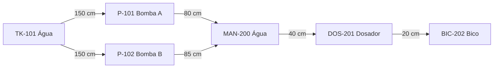

# Aula 14 — Menor Caminho: Dijkstra e Roteamento Dinâmico

**UNIFEI • ECAA08 Automática • Grupo 2**
**Projeto:** SCADA da Máquina Pneumática de Envasamento de Água em Copos.

## 1. Objetivo e vínculo com o projeto

Calcular a menor distância entre equipamentos da rede de abastecimento, recalculando a rota após bloqueio de equipamento, isolamento de tubulação ou alteração de comprimento. O entregável é a classe `DijkstraRouter`, implementada integralmente no notebook de mesmo nome desta aula.

A rede preserva os nomes e os nove trechos do modelo das Aulas 11 e 15. Bombas redundantes e comprimentos pertencem àquela abstração didática; não constituem levantamento físico validado. O resultado é uma **proposta de rota**. Nenhum comando é enviado ao Automation Studio, às válvulas ou aos cilindros. O sequenciamento e os permissivos continuam pertencendo ao controle da máquina.

| Origem | Destino | Comprimento (cm) |
|---|---|---:|
| TK-101_Agua | P-101_BombaA | 150 |
| TK-101_Agua | P-102_BombaB | 150 |
| P-101_BombaA | MAN-200_Agua | 80 |
| P-102_BombaB | MAN-200_Agua | 85 |
| MAN-200_Agua | DOS-201_Dosador | 40 |
| DOS-201_Dosador | BIC-202_Bico | 20 |
| BIC-202_Bico | MESA-000_Index | 10 |
| MAG-100_Copos | MESA-000_Index | 15 |
| MESA-000_Index | EST-500_Saida | 50 |

O cadastro completo permite comparar com as aulas anteriores. A consulta hidráulica principal termina no dosador, evitando interpretar o transporte do copo como tubulação. `DOS-201_Dosador` representa o cilindro C; `BIC-202_Bico`, o bico; `MESA-000_Index`, a mesa movimentada por M-001; `EST-500_Saida`, a esteira M-002. São identificadores topológicos herdados, não novas tags de instrumentação.

## 2. Formulação matemática

Para um dígrafo $G=(V,E,w)$ com $w:E\to\mathbb{R}_{\geq0}$, procuramos um caminho $P$ de $s$ até $t$ que minimize:

$$C(P)=\sum_{(u,v)\in P}w(u,v).$$

Inicializamos $d(s)=0$, $d(v)=\infty$ para os demais vértices. Ao retirar do heap o vértice com menor distância provisória, relaxamos suas arestas:

$$d(u)+w(u,v)<d(v)\Rightarrow d(v)\leftarrow d(u)+w(u,v),\quad pred(v)\leftarrow u.$$

Os predecessores permitem reconstruir a sequência final de equipamentos. Entradas antigas do heap são descartadas se sua distância não coincide com a melhor conhecida. Pesos zero são aceitos; negativos, NaN e infinitos são rejeitados. Indisponibilidade é representada por um conjunto de trechos bloqueados, preservando seu custo original para restauração.

**Justificativa:** com custos não negativos, uma continuação de caminho não reduz a distância já acumulada. Se houvesse caminho mais curto para o vértice mínimo retirado, sua primeira passagem pela fronteira dos vértices já processados teria oferecido uma distância menor no heap, contrariando essa escolha. A hipótese deixa de valer com pesos negativos.

Com listas de adjacência e heap binário, o custo usual para grafo simples é $O((|V|+|E|)\log|V|)$; a validação inicial percorre $O(|V|+|E|)$. O espaço é $O(|V|+|E|)$. Não há cache: toda consulta usa os pesos e as indisponibilidades atuais.

## 3. Interface e comportamento

| Operação | Comportamento |
|---|---|
| `calcular_menor_caminho(origem, destino)` | Retorna `(distancia, lista_de_equipamentos)` |
| `bloqueios={...}` | Exclui os equipamentos apenas nessa consulta |
| `arestas_bloqueadas={(u,v)}` | Exclui trechos apenas nessa consulta |
| `bloquear_trecho(u,v)` / `restaurar_trecho(u,v)` | Atualiza disponibilidade persistente do modelo |
| `atualizar_peso(u,v,valor)` | Atualiza custo finito; próxima consulta recalcula |
| Destino inalcançável ou terminal bloqueado | Retorna `(inf, [])` |
| Origem igual ao destino e disponível | Retorna `(0.0, [origem])` |
| Vértice/aresta desconhecido ou peso inválido | Levanta `ValueError` |

Não se converte erro de cadastro em “sem rota”: os dois resultados têm significados diferentes. Rotas empatadas podem ter mais de uma solução ótima; a implementação usa a ordem textual do heap para manter comportamento reproduzível. A estrutura é um grafo simples; conexões paralelas devem ser modeladas por nós intermediários ou por uma extensão explícita para multigrafos.

## 4. Exemplo resolvido e investigações

Da água até o dosador, a rota A custa $150+80+40=270$ cm; a B custa $150+85+40=275$ cm.

| Retirada válida do heap | Distância (cm) | Relaxação principal |
|---|---:|---|
| TK-101_Agua | 0 | Bombas A e B recebem 150 |
| P-101_BombaA | 150 | Manifold recebe 230 |
| P-102_BombaB | 150 | Candidato 235 não melhora 230 |
| MAN-200_Agua | 230 | Dosador recebe 270 |
| DOS-201_Dosador | 270 | Destino atingido |

1. **Traçado completo:** a tabela acima e `ultima_trilha` do notebook confirmam a distância nominal. Não há ciclo dirigido na bifurcação convergente das bombas; alternativas de caminho não exigem um ciclo dirigido.
2. **Peso −5:** o notebook rejeita essa entrada. Com uma aresta negativa, um vértice retirado antes pode ser melhorado depois; seria necessário outro algoritmo, como Bellman–Ford, e análise de ciclos negativos.
3. **Todos os pares:** repetir Dijkstra custa aproximadamente $O(|V|(|V|+|E|)\log|V|)$; Floyd–Warshall custa $O(|V|^3)$ e guarda $O(|V|^2)$ distâncias. Não existe um número universal de vértices de equilíbrio: a densidade $|E|$, a implementação e a quantidade de consultas também importam. Em grafos esparsos, Dijkstra repetido tende a ter melhor ordem assintótica; em densos, Floyd pode ser adequado.
4. **Bloqueio do manifold:** ambas as rotas se tornam inviáveis; o resultado é `(inf, [])`. A redundância das bombas não cobre o trecho comum até o dosador.
5. **Recálculo:** isolando a linha A, a rota passa por B com 275 cm. Isolando A e B, não há rota. Restaurando os trechos, voltamos a 270 cm. Alterando o comprimento A→manifold para 100 cm, A passa a custar 290 cm e B volta a ser ótima com 275 cm.

## 5. Validação executável

O notebook inclui verificações de rota completa e soma dos pesos, falha/restauração de trechos, bloqueio de nós, sentido das arestas, origem=destino, consulta sem mutação e rejeição de entradas inválidas. Um oráculo independente enumera caminhos simples de um grafo pequeno com ciclo, pesos zero e nó isolado: são **150 comparações** de distância em todos os pares, sem bloqueio e com cada bloqueio individual.

Esse oráculo serve somente aos testes; seu custo exponencial não é usado no roteamento. O arquivo possui saídas gravadas de execução local das células em ordem. Execute novamente para validar em seu ambiente; não execute com otimização `python -O`, que desativa `assert`.

## 6. Execução, limites e conclusão

Abra o notebook de mesmo nome no Jupyter ou Google Colab e execute todas as células em ordem, em Python 3.10 ou superior. Só são usados módulos da biblioteca padrão; nenhuma instalação, arquivo externo ou acesso à rede é necessário durante a execução.

As distâncias não representam perda de carga, vazão, tempo de atuação ou capacidade de bombeamento. Não há ensaio de hardware, comunicação com Automation Studio nem medição de latência de uma malha industrial. Um cálculo de rota não autoriza contornar dosagem, qualidade ou intertravamentos. Não foram alterados os arquivos 11 ou 15; este notebook é autônomo para preservar esse limite de escopo.

O entregável demonstra menor caminho, recálculo por peso e bloqueio, retorno de sequência/distância e tratamento explícito de falhas de cadastro e ausência de rota.

## 7. Referências e rastreabilidade

- [Roteiro da Aula 14 do professor](https://github.com/valerio-unifei/ECAA08-2026.2-Projeto/blob/c70e838aac076856727d0bb2151d20ff23d08600/etapa-02-grafos/14%20-%20Menor%20Caminho%20Dijkstra%20e%20Roteamento%20Dinamico.md).
- [Modelo do Grupo 2 — Aula 11](https://github.com/poggerssLL/Automatica---Grupo-2/blob/b25ada3f919adb3011a792fe62736cc941ac6c23/etapa-02-grafos/11%20-%20Modelagem%20da%20Tubulacao%20e%20Instrumentos%20como%20Grafo.md).
- [Modelo do Grupo 2 — Aula 15](https://github.com/poggerssLL/Automatica---Grupo-2/blob/b25ada3f919adb3011a792fe62736cc941ac6c23/etapa-02-grafos/15%20-%20Simulacao%20de%20Vazamentos%20e%20Desvio%20Automatico.md).
