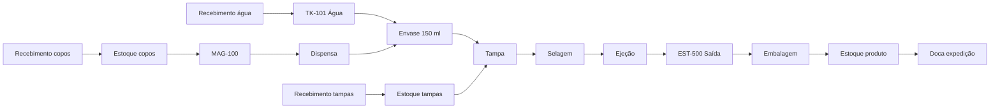
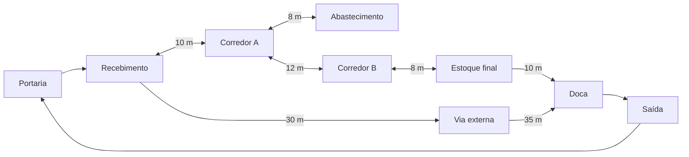

# Aula 18 — Grafos de Logística de Insumos e Produtos Acabados

**UNIFEI • ECAA08 Automática • Grupo 2**
**Projeto:** SCADA da Máquina Pneumática de Envasamento de Água em Copos.

## 1. Situação-problema e adaptação do roteiro

A máquina recebe copos, água própria para consumo, tampas e ar comprimido. O copo passa por dispensa, envase de 150 ml, posicionamento de tampa, termosselagem e ejeção para a esteira. A Aula 18 amplia a visão para recebimento, abastecimento, estoque e expedição, separando **fluxo de materiais** de **circulação de veículos internos**.

O roteiro do professor usa uma fábrica de fertilizantes. Aqui o mesmo princípio matemático é aplicado à envasadora. Embalagem secundária, estoques externos, portaria, doca e corredores são **extensões didáticas propostas**, pois o projeto-base não fornece um layout fabril medido. Não são instalações concluídas nem novas tags físicas. Os comprimentos são hipóteses explícitas para comparar rotas.

| Elemento do projeto | Representação nesta entrega |
|---|---|
| Copos plásticos | Recebimento → estoque → MAG-100 → E1 |
| Água | Recebimento → TK-101 → E2 |
| Tampas | Recebimento → estoque → E3 |
| Ar comprimido | Utilidade necessária; não é ingrediente do produto nem via de veículo |
| Cinco estações | E1 dispensa → E2 envase → E3 tampa → E4 selagem → E5 ejeção |
| Esteira M-002 | EST-500_Saida → embalagem → estoque de produto → doca |

## 2. Dois modelos para perguntas diferentes

| Camada | Vértices/arestas | Peso | Pergunta |
|---|---|---|---|
| $G_M$: materiais | Recebimentos, estoques e etapas de transformação | Distância estimada em m | Por onde um insumo se incorpora ao processo e segue até expedição? |
| $G_V$: veículos | Áreas acessíveis e corredores autorizados | Distância em m; modelo separado para tempo em min | Por onde o veículo interno pode circular? |

Uma ligação entre E2 e E3 representa a progressão do copo na mesa, não uma rua. O veículo não atravessa dosador, prensa ou cabeçote. Identificadores de camadas diferentes não são intercambiáveis. Uma camada específica de alocação de estoque seria uma extensão futura; o entregável atual implementa os dois modelos centrais solicitados.

## 3. Grafo de materiais

| Origem | Destino | Distância estimada (m) |
|---|---|---:|
| RECEB_COPOS | ESTOQUE_COPOS | 8 |
| ESTOQUE_COPOS | MAG-100_Copos | 6 |
| MAG-100_Copos | E1_DISPENSA | 1 |
| RECEB_AGUA | TK-101_Agua | 10 |
| TK-101_Agua | E2_ENVASE | 2,7 |
| RECEB_TAMPAS | ESTOQUE_TAMPAS | 7 |
| ESTOQUE_TAMPAS | E3_TAMPA | 5 |
| E1→E2; E2→E3; E3→E4; E4→E5 | Cada avanço lógico | 0,6 por trecho |
| E5_EJECAO | EST-500_Saida | 0,8 |
| EST-500_Saida | EMBALAGEM | 3 |
| EMBALAGEM | ESTOQUE_PRODUTO | 5 |
| ESTOQUE_PRODUTO | DOCA_EXPEDICAO | 8 |

O valor 2,7 m mantém a referência nominal de 270 cm até o dosador da Aula 14, agregada ao abastecimento de E2. Os demais valores são estimativas didáticas; em particular, 0,6 m não é uma medição do passo angular da mesa. O modelo logístico agrega a rede hidráulica, sem repetir sua redundância interna.

**Cuidado semântico:** um caminho de água começa em E2 e um de tampas em E3 porque esses insumos se incorporam nesses pontos. Isso não autoriza fabricar um copo pulando E1 ou E2. A rota do copo obrigatoriamente contém E1–E5 em ordem. Convergência de arestas é uma possibilidade de transferência; não representa sozinha uma operação AND, balanço de massa ou sincronismo. O notebook demonstra separadamente a disponibilidade conjunta de copos, água, tampas e ar. Essa verificação não substitui estoque quantitativo, rastreabilidade sanitária ou permissivos do controlador.

### 3.1. Propriedade DAG

O fluxo normal modelado não retorna a uma etapa anterior: é um grafo acíclico dirigido. A implementação de Kahn verifica essa propriedade em $O(|V|+|E|)$ e produz uma ordem topológica. Para toda aresta $(u,v)$, sua posição satisfaz $ord(u)<ord(v)$.

A mesa física gira ciclicamente, mas os vértices deste grafo representam o progresso de uma unidade de produto, não a posição periódica do mecanismo. Retrabalho, reciclagem ou devolução exigiriam modelagem adicional; um processo industrial não é necessariamente DAG em qualquer abstração.

## 4. Circulação interna de veículos

O trecho Portaria→Recebimento tem 20 m; Doca→Saída, 15 m; Saída→Portaria, 10 m. Cada sentido de uma via de mão dupla é uma aresta explícita. Vias sem reverso cadastrado são de sentido único. O anel de circulação contém ciclos legítimos e não deve ser submetido à exigência de aciclicidade do fluxo normal de materiais.

O modelo descreve um veículo/carrinho de movimentação interna em uma área hipotética da instalação. Ele não supõe que um caminhão possa entrar na máquina. Compatibilidade de veículo, largura, capacidade e segregação de pessoas dependem de um layout real e não são validadas por estes pesos.

## 5. Menor caminho e exemplos resolvidos

A classe `GrafoLogistico` cadastra conexões dirigidas e ponderadas e usa Dijkstra para minimizar $\sum w(u,v)$, com pesos finitos não negativos. O notebook inclui toda a implementação, sem depender de outros arquivos. Bloqueios de nós/trechos, retorno `(inf, [])` e rejeição de entradas inválidas seguem a Aula 14. A complexidade usual é $O((|V|+|E|)\log|V|)$ por consulta.

**Copo até expedição:**

$$8+6+1+4(0{,}6)+0{,}8+3+5+8=34{,}2\text{ m}.$$

A sequência é RECEB_COPOS → ESTOQUE_COPOS → MAG-100 → E1 → E2 → E3 → E4 → E5 → ESTEIRA → EMBALAGEM → ESTOQUE_PRODUTO → DOCA. O validador verifica adjacência, soma dos pesos e presença das cinco operações. Há uma única sequência permitida de fabricação; Dijkstra não inventa alternativas tecnicamente proibidas.

**Veículo do recebimento até doca:** a rota pelos corredores custa $10+12+8+10=40$ m. A via externa custa $30+35=65$ m. Sem restrições, escolhemos 40 m. Bloqueado o corredor B, escolhemos 65 m. Bloqueados B e via externa, não existe rota.

## 6. Investigações resolvidas no notebook

1. **Rotas até estoques:** as consultas dos três recebimentos até seus estoques locais custam 8 m para copos, 10 m para água e 7 m para tampas. Também se apresentam as rotas completas até expedição: 34,2 m, 31,3 m e 30 m, respectivamente. As diferenças refletem o ponto de incorporação; não são comparação entre três receitas alternativas de produto.
2. **Armazenagem indisponível:** bloquear EMBALAGEM→ESTOQUE_PRODUTO torna a rota do copo até a doca inviável. O modelo não cria um atalho contornando armazenagem ou qualidade.
3. **Mão dupla para mão única:** remover CORREDOR_B→CORREDOR_A preserva A→B. O notebook valida que ainda existe o anel Portaria→Recebimento→A→B→Estoque→Doca→Saída→Portaria. Um caminho de um vértice até ele mesmo, de custo zero, não é usado como prova de existência de ciclo.
4. **Distância versus tempo:** em outro grafo, todos os custos são convertidos para minutos. Com velocidades hipotéticas de 2 m/min nos corredores e 10 m/min na via externa, a rota curta custa 20 min e a externa 6,5 min. O caminho mais curto em metros não é o mais rápido. As unidades nunca se somam na mesma consulta.
5. **Quarentena:** um submodelo RECEBIMENTO→QUARENTENA→ESTOQUE_LIBERADO começa com a saída bloqueada. Somente aprovação booleana explícita libera a transferência. Reprovação posterior volta a bloqueá-la. Isso representa a decisão de qualidade, não um resultado de Dijkstra.

## 7. Critérios de aceitação e execução

| Critério | Evidência executável |
|---|---|
| Dois grafos coerentes e separados | `criar_fluxo_materiais()` e `criar_circulacao_veiculos()` |
| Origem recebimento e destino expedição | Três consultas de insumo e validação completa da rota do copo |
| Respeito às operações obrigatórias | Asserts de ordem E1–E5 e bloqueio individual de cada estação |
| Pesos e distâncias consistentes | Soma independente das arestas pelo validador |
| DAG de materiais | Kahn e verificação de todas as arestas na ordem topológica |
| Sentidos e contingências | Remoção de reverso, rota alternativa, duplo bloqueio e restauração |
| Custo homogêneo e qualidade | Grafos separados m/min e liberação/rebloqueio da quarentena |

Abra o notebook de mesmo nome em Jupyter ou Colab, selecione Python 3.10 ou superior e execute todas as células em ordem. Somente biblioteca padrão; sem instalação adicional, imagens externas ou conexão de rede durante a execução. As saídas gravadas foram produzidas por execução local das células em ordem; reexecute no seu ambiente. Os testes usam `assert`, portanto não devem ser executados com `python -O`.

## 8. Limitações e conclusão

Este é um modelo computacional didático. Não demonstra implantação física, comunicação SCADA/Automation Studio, capacidade logística, layout medido, lotes reais ou controle industrial validado. Os valores de distância/velocidade devem ser substituídos por medições se houver uma aplicação real. Não foram alterados arquivos de outras aulas.

O entregável implementa os dois grafos, Dijkstra, a rota completa de recebimento à expedição, validação estrutural da sequência e as investigações adaptadas ao projeto. Separar as camadas permite discutir abastecimento e circulação sem confundir tubulação, trajetória do copo e caminho do veículo.

## 9. Referências e rastreabilidade

- [Roteiro da Aula 18 do professor](https://github.com/valerio-unifei/ECAA08-2026.2-Projeto/blob/c70e838aac076856727d0bb2151d20ff23d08600/etapa-02-grafos/18%20-%20Grafos%20de%20Logistica%20de%20Insumos%20e%20Produtos%20Acabados.md).
- [Descrição técnica da envasadora — Grupo 2](https://github.com/poggerssLL/Automatica---Grupo-2/blob/b25ada3f919adb3011a792fe62736cc941ac6c23/README.md).
- [Insumos do Grupo 2](https://github.com/poggerssLL/Automatica---Grupo-2/blob/b25ada3f919adb3011a792fe62736cc941ac6c23/etapa-01-logica/01%20-%20Insumos.md).
