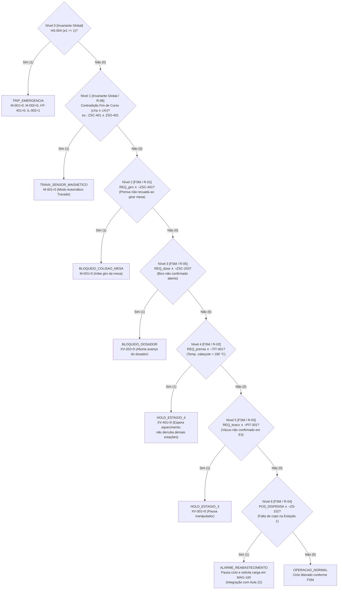

<div align="center">
  <h2>Universidade Federal de Itajubá (UNIFEI)</h2>
  <p>Engenharia de Controle e Automação | Disciplina: Automática (ECAA08)</p>
  <p>Projeto: SCADA — Máquina Pneumática de Envasamento de Água em Copos (Aqua Index)</p>
  <hr>
</div>

# Aula 21 — Aplicações de Árvores Binárias no SCADA Aqua Index

**Árvore Binária de Decisão (BDT) Contextual de Intertravamentos e Árvore AVL no Historiador SCADA**

### Informações do Projeto

| Especificação Técnica | Detalhes |
| :--- | :--- |
| **Unidade Operacional** | Máquina Pneumática de Envasamento de Água em Copos — **Aqua Index** (Setores 000 a 500) |
| **Domínio de Engenharia** | Automação Industrial, Lógica de Intertravamento, Telemetria SCADA e Matemática Discreta |
| **Estruturas de Dados** | Árvore Binária de Decisão (BDT) Contextual e Árvore Binária de Busca Auto-Balanceada (AVL) |
| **Escopo e Natureza** | Modelo conceitual e simulado de caráter acadêmico/didático (ECAA08 — Grupo 2) |
| **Código de Verificação** | [`Aula 21 - Árvores Binárias - code.ipynb`](Aula%2021%20-%20Árvores%20Binárias%20-%20code.ipynb) |

> **Nota de Escopo Conceitual:** Em conformidade com a definição do projeto **Aqua Index**, toda a modelagem descrita neste relatório é conceitual e voltada à simulação didática (Automation Studio $\leftrightarrow$ SCADA). O sistema não corresponde a uma máquina física construída nem reivindica certificação de segurança funcional segundo a norma IEC 61511 / SIL.

---

## 1. Árvore Binária de Decisão (BDT) Contextual — Intertravamentos da Envasadora

### 1.1 Contextualização: Invariantes Globais vs. Intertravamentos Dependentes da FSM

Na envasadora rotativa **Aqua Index**, cinco estações (`E1` a `E5`) operam em sincronismo com uma mesa indexadora acionada pelo servomotor `M-001` e monitorada pelo encoder `SE-001`. Um erro comum ao projetar árvores de decisão industriais é tratar todos os sensores da planta como *trips* globais incondicionais. Na prática de controle sequencial, essa abordagem inviabiliza a operação:

* O pressostato de vácuo `PIT-301` estar em `0` (sem vácuo) é **completamente normal** enquanto o manipulador `XV-301`/`XV-302` está em repouso ou retornando após depositar a tampa — só configura falha quando a FSM da Estação 3 solicita o giro do braço com tampa (`REQ_braco = 1`).
* O sensor de bico aberto `ZSC-203` estar em `0` é o estado esperado fora da janela de envase — só representa risco de sobrepressão hidráulica quando a FSM da Estação 2 comanda o avanço do dosador (`REQ_dose = 1`).
* A temperatura `TIT-401` abaixo de $180^\circ\text{C}$ durante o aquecimento inicial (*warm-up*) ou entre lotes exige **espera localizada** (*hold*) na Estação 4 (`HOLD_ESTAGIO_4`), **sem derrubar** a energização geral ou a esteira de saída `M-002`.

Por isso, a BDT da **Aqua Index** separa rigorosamente os predicados em duas camadas estruturais:

1. **Invariantes Globais (Níveis 0 e 1):** Condições que nunca podem ser violadas, independentemente do passo em que a Máquina de Estados Finitos (FSM) se encontra — o botão físico de emergência `HS-004` ($e_1$) e a contradição elétrica simultânea em qualquer par de fins de curso magnéticos opostos ($c_{Xa} \land c_{Xr}$, Regra `R-06`).
2. **Intertravamentos Condicionais Habilitados pela FSM (Níveis 2 a 6):** Predicados compostos do tipo $\text{Permissivo\_FSM} \land \neg \text{Sensor\_Confirmacao}$, ligados diretamente às regras `R-01`, `R-05`, `R-02`, `R-03` e `R-04` da Base de Conhecimento da Etapa 01.

### 1.2 Formalização Matemática e Arbitragem sem Mascaramento de Alarmes

Modela-se a árvore de intertravamento como um grafo acíclico orientado $T = (V, E)$, em que:

* $V = V_{\text{interno}} \cup V_{\text{folha}}$, com $|V_{\text{interno}}| = 7$ nós de decisão e $|V_{\text{folha}}| = 8$ estados de ação;
* Cada vértice interno $u \in V_{\text{interno}}$ avalia um predicado booleano $P_u(\mathbf{x}, \mathbf{q}) \in \{0, 1\}$, função do vetor de sensores ISA-5.1 ($\mathbf{x}$) e do estado ativo das solicitações da FSM ($\mathbf{q}$);
* $E$ contém as arestas orientadas rotuladas por $\{1 = \text{Sim (Violação/Condição Ativa)},\; 0 = \text{Não (Conforme)}\}$.

#### Curto-Circuito Determinístico vs. Barramento Paralelo de Alarmes

A BDT executa **avaliação por curto-circuito** ordenada estritamente por severidade (da parada de emergência global até o aviso de reabastecimento). Como a altura da árvore é fixa ($h = 7$), o caminho da raiz até a folha de atuação tem complexidade estritamente constante:

$$T_{\text{BDT}} = \mathcal{O}(h) = \mathcal{O}(7) = \mathcal{O}(1)$$

Entretanto, em supervisão industrial SCADA, o curto-circuito resolve **exclusivamente a arbitragem da ação segura determinística** enviada aos atuadores (garantindo que nunca haja comandos contraditórios sobre `M-001`, `XV-202` ou `HT-401`). Para impedir que uma falha de maior severidade **mascare** anomalias simultâneas para o operador e para a equipe de manutenção, o motor de supervisão mantém um **barramento paralelo de alarmes** $\mathbf{A}(t) \in \{0, 1\}^7$:

$$\mathbf{A}(t) = \big[ P_0(t),\; P_1(t),\; P_2(t),\; P_3(t),\; P_4(t),\; P_5(t),\; P_6(t) \big]$$

Assim, se o botão `HS-004` for pressionado no mesmo instante em que a prensa não está recuada (`R-01`) e falta copo em `E1` (`R-04`), a BDT garante em $\mathcal{O}(1)$ a ação de maior prioridade (`TRIP_EMERGENCIA`), enquanto o barramento paralelo registra **todos os 3 alarmes ativos** na IHM e no Historiador SCADA para diagnóstico pós-evento.

### 1.3 Topologia da Árvore Binária de Decisão Contextual (Mermaid)



### 1.4 Mapeamento Determinístico Completo com Tags ISA-5.1

Os 7 pares de fins de curso magnéticos monitorados na Regra `R-06` abrangem todos os cilindros de curso duplo/monitorado da planta: Cilindro A (`ZSC-101 ∧ ZSO-101`), Cilindro C (`ZSO-202 ∧ ZSC-202`), Cilindro D (`ZSO-301 ∧ ZSC-301`), Cilindro E (`ZSO-302 ∧ ZSC-302`), Cilindro F / Prensa (`ZSO-401 ∧ ZSC-401`), Cilindro G (`ZSO-501 ∧ ZSC-501`) e Cilindro H (`ZSC-502 ∧ ZSO-502`).

| Nível ($h$) | Camada de Segurança | Regra Ref. | Tags ISA-5.1 / Flags FSM | Predicado Booleano | Ação Determinística (Folha) | Comando nos Atuadores e Efeito |
| :---: | :--- | :---: | :--- | :--- | :--- | :--- |
| **0 (Raiz)** | Invariante Global | Emergência | `HS-004` ($e_1$) | $e_1 = 1$ | `TRIP_EMERGENCIA` | `M-001=0`, `M-002=0`, `HT-401=0`, `IL-002=1` (parada imediata geral) |
| **1** | Invariante Global | `R-06` | Pares `ZSC-x`/`ZSO-x` (ex.: `ZSC-401`, `ZSO-401`) | $\bigvee_{k} (c_{k,a} \land c_{k,r})$ | `TRAVA_SENSOR_MAGNETICO` | `M-001=0`; trava ciclo automático por incoerência elétrica em fim de curso |
| **2** | Intertravamento FSM | `R-01` | `REQ_giro`, `ZSC-401` ($c_{7r}$) | $\text{REQ\_giro} \land \neg c_{7r}$ | `BLOQUEIO_COLISAO_MESA` | `M-001=0`; impede indexação da mesa enquanto a prensa não recua |
| **3** | Intertravamento FSM | `R-05` | `REQ_dose`, `ZSC-203` ($c_4$) | $\text{REQ\_dose} \land \neg c_4$ | `BLOQUEIO_DOSADOR` | `XV-202=0`; aborta injeção de 150 mL para evitar sobrepressão com bico fechado |
| **4** | Intertravamento FSM | `R-02` | `REQ_prensa`, `TIT-401` ($t_1$) | $\text{REQ\_prensa} \land \neg t_1$ | `HOLD_ESTAGIO_4` | `XV-401=0`, mantém `HT-401=1`; aguarda $T \ge 180^\circ\text{C}$ **sem derrubar a máquina** |
| **5** | Intertravamento FSM | `R-03` | `REQ_braco`, `PIT-301` ($p_1$) | $\text{REQ\_braco} \land \neg p_1$ | `HOLD_ESTAGIO_3` | `XV-301=0`; pausa giro do braço *pick-and-place* até confirmar sucção da tampa |
| **6** | Intertravamento FSM | `R-04` | `POS_DISPENSA`, `ZS-102` ($s_1$) | $\text{POS\_DISPENSA} \land \neg s_1$ | `ALARME_REABASTECIMENTO` | Pausa novo ciclo e sinaliza reabastecimento do magazine `MAG-100` (elo com a **Aula 22**) |
| **7 (Folha)** | Nominal | — | Todas as condições satisfeitas | $\bigwedge_{i=0}^{6} \neg P_i$ | `OPERACAO_NORMAL` | Máquina liberada para seguir a FSM nominal das estações `E1` a `E5` |

### 1.5 Análise de Complexidade e Propriedades de Tempo Real (Modelo Simulado)

1. **Limite Superior Estrito:** A avaliação da BDT percorre no máximo $7$ comparações booleanas ($h = 7$), assegurando custo de pior caso $\mathcal{O}(1)$ por varredura do ciclo de supervisão simulado.
2. **Separação Limpa de Escopo de Parada:** Diferentemente de um modelo simplista em que toda falha aciona parada geral, a BDT contextual distingue:
   * **Trips / Bloqueios Críticos** (`TRIP_EMERGENCIA`, `TRAVA_SENSOR_MAGNETICO`, `BLOQUEIO_COLISAO_MESA`, `BLOQUEIO_DOSADOR`);
   * **Estados de Espera Localizados (*Hold*)** (`HOLD_ESTAGIO_4`, `HOLD_ESTAGIO_3`), que preservam a produtividade e evitam reinicializações destrutivas;
   * **Evento Logístico de Insumo** (`ALARME_REABASTECIMENTO`), que integra a lógica de controle à gestão de estoque de copos no magazine `MAG-100`.

---

## 2. Árvore Binária de Busca Auto-Balanceada (AVL) — Historiador SCADA & Consulta Ordenada

### 2.1 Por que usar Árvore AVL em vez de um Vetor Cronológico Simples?

Uma pergunta legítima de engenharia de software industrial é: *se os registros do Historiador possuem carimbo de tempo crescente, por que não simplesmente fazer `append()` em um vetor cronológico e usar busca binária?*

Na arquitetura real **Cliente-Servidor** do **Aqua Index** (Automation Studio $\leftrightarrow$ SCADA via rede), essa suposição falha por três razões técnicas concretas:

1. **Chegada Assíncrona e Fora de Ordem (*Out-of-Order Ingestion*):**
   * Pacotes oriundos da simulação do processo sofrem *jitter* na camada de rede TCP/IP;
   * Comandos do operador na IHM (ex.: acionamento de `HS-001`, `HS-003` ou reconhecimento de alarme) são carimbados localmente e intercalados com eventos de campo;
   * Após microdesconexões Cliente-Servidor, o *buffer* local do servidor reenvia eventos atrasados com *timestamps* pretéritos ($\tau_{\text{reenvio}} < \tau_{\text{atual}}$).
   * Em um vetor ordenado, inserir um evento atrasado exige deslocamento de elementos em $\mathcal{O}(N)$ por inserção (ou reordenação completa em $\mathcal{O}(N \log N)$), degradando o Historiador sob rajadas de reconexão.
2. **Aquisição Híbrida: Mudança de Estado (CoS) + Leituras Analógicas Periódicas:**
   * Em coerência direta com o argumento anti-redundância da **Aula 20 (Compressão de Huffman)**, gravar continuamente *frames* idênticos de sinais discretos a cada $10\text{ ms}$ desperdiça banda e armazenamento.
   * Por isso, o Historiador **Aqua Index** adota registro por **Mudança de Estado (*Change-of-State — CoS*)** para as variáveis discretas (fins de curso, capacitivos, válvulas solenoides e transições da BDT) combinado com **amostragem periódica** para as grandezas analógicas contínuas: temperatura do cabeçote de termosselagem (`TIT-401`, em $^\circ\text{C}$) e ângulo da mesa indexadora (`SE-001`, em graus de $0^\circ$ a $360^\circ$).
   * Isso gera intervalos temporais irregulares e multi-origem, onde uma estrutura dinâmica ordenada é indispensável.
3. **Proteção contra Degeneração de BST Comum:**
   * Se usássemos uma Árvore Binária de Busca (BST) sem balanceamento, longos trechos de eventos em ordem quase cronológica fariam a árvore degenerar em uma lista encadeada com altura $h \approx N$, derrubando inserções e buscas para $\mathcal{O}(N)$.
   * A **Árvore AVL** (Adelson-Velsky e Landis, 1962) elimina ambos os gargalos: tanto em rajadas estritamente cronológicas quanto em fluxos fortemente fora de ordem, sua altura é limitada por $h < 1{,}4405 \log_2(N + 2) - 0{,}328$, garantindo $\mathcal{O}(\log N)$ no pior caso.

### 2.2 Estrutura do Nó do Historiador na Memória

Cada nó $N$ da Árvore AVL indexa um evento pela chave única $\tau \in \mathbb{N}$ (*timestamp* em milissegundos, com desempatador determinístico de sequência quando dois eventos compartilham o mesmo milissegundo):

$$N = \Big\langle \tau,\; h(N),\; \text{esq},\; \text{dir},\; \mathbf{D}(\tau) \Big\rangle$$

Onde o *payload* $\mathbf{D}(\tau)$ registra:

$$\mathbf{D}(\tau) = \Big\{ \text{tipo} \in \{\text{CoS}, \text{ANALOG}, \text{IHM}\},\; \text{origem},\; \text{tag},\; \text{valor},\; \text{TIT\_401\_C},\; \text{SE\_001\_deg},\; \text{acao\_BDT} \Big\}$$

### 2.3 Topologia, Fator de Balanceamento ($BF$) e Rotações em $\mathcal{O}(1)$

```text
                       [τ = 10040 ms | ANALOG TIT-401]  (h=3, BF=0)
                            /                                \
                           /                                  \
        [τ = 10015 ms | CoS ZSC-401]               [τ = 10080 ms | IHM HS-003]
                (h=2, BF=-1)                                (h=2, BF=0)
                   /                                      /             \
                  /                                      /               \
   [τ = 10002 ms | CoS ZS-102]        [τ = 10055 ms | CoS PIT-301]  [τ = 10110 ms | ANALOG SE-001]
          (h=1, BF=0)                         (h=1, BF=0)                    (h=1, BF=0)
```

Para todo nó $n \in V$, definindo $h(\text{nulo}) = 0$ e $h(n) = 1 + \max\big(h(n.\text{esq}),\, h(n.\text{dir})\big)$, a invariante AVL exige que o **Fator de Balanceamento** satisfaça:

$$BF(n) = h(n.\text{dir}) - h(n.\text{esq}) \in \{-1,\; 0,\; +1\}$$

Sempre que uma inserção viola $|BF(n)| \le 1$, a árvore restaura o balanceamento em tempo constante $\mathcal{O}(1)$ por meio de exatamente uma das quatro rotações canônicas:

| Caso | Condição de Desequilíbrio | Operação de Rebalanceamento | Complexidade |
| :---: | :--- | :--- | :---: |
| **LL** | $BF(n) = -2$ e $BF(n.\text{esq}) \le 0$ | Rotação Simples à Direita em $n$ | $\mathcal{O}(1)$ |
| **RR** | $BF(n) = +2$ e $BF(n.\text{dir}) \ge 0$ | Rotação Simples à Esquerda em $n$ | $\mathcal{O}(1)$ |
| **LR** | $BF(n) = -2$ e $BF(n.\text{esq}) > 0$ | Rotação à Esquerda em $n.\text{esq}$, seguida de Rotação à Direita em $n$ | $\mathcal{O}(1)$ |
| **RL** | $BF(n) = +2$ e $BF(n.\text{dir}) < 0$ | Rotação à Direita em $n.\text{dir}$, seguida de Rotação à Esquerda em $n$ | $\mathcal{O}(1)$ |

### 2.4 Consulta Pontual e Consulta por Intervalo $[t_{\text{início}}, t_{\text{fim}}]$ com Poda

Para gerar gráficos de tendência e realizar **Análise de Causa-Raiz (RCA)** após um evento (por exemplo, investigar a queda térmica em `TIT-401` nos $5\text{ s}$ anteriores a um `HOLD_ESTAGIO_4` ou a sequência de sensores antes de um `BLOQUEIO_COLISAO_MESA`), executa-se um percurso *in-order* com poda de subárvores fora do intervalo:

$$\text{BuscaIntervalo}(n, t_1, t_2): \begin{cases} \text{se } n.\tau > t_1 \implies \text{explora } n.\text{esq} \\ \text{se } t_1 \le n.\tau \le t_2 \implies \text{coleta } \mathbf{D}(n.\tau) \\ \text{se } n.\tau < t_2 \implies \text{explora } n.\text{dir} \end{cases}$$

```text
                        COMPARAÇÃO DE COMPLEXIDADE (HISTORIADOR SCADA)
┌─────────────────────────────────────────┬───────────────────┬───────────────────┬──────────────────────┐
│ Operação                                │ Vetor Ordenado    │ BST Não Balanceada│ Árvore AVL (Garantida)│
├─────────────────────────────────────────┼───────────────────┼───────────────────┼──────────────────────┤
│ Inserção fora de ordem (jitter/reenvio) │ O(N)              │ O(N) pior caso    │ O(log₂ N)            │
│ Inserção estritamente cronológica       │ O(1) amortizado   │ O(N) degenerada!  │ O(log₂ N)            │
│ Consulta pontual por timestamp τ        │ O(log₂ N)         │ O(N) pior caso    │ O(log₂ N)            │
│ Consulta por intervalo [t₁, t₂]         │ O(log₂ N + K)     │ O(N) pior caso    │ O(log₂ N + K)        │
└─────────────────────────────────────────┴───────────────────┴───────────────────┴──────────────────────┘
```

*Onde $N$ é o número total de registros no Historiador e $K$ é a quantidade de eventos retornados na janela temporal $[t_{\text{início}}, t_{\text{fim}}]$.*

### 2.5 Aplicação Complementar: Indexação Ordenada das 45 Tags ISA-5.1 por AVL

O mapeamento completo da **Aqua Index** (`02 - Mapeamento_de_variaveis.md`) possui exatamente **45 tags ISA-5.1** distribuídas nos 6 setores da planta:

* Setor `000` (Controle Geral): 11 tags (`M-001` a `IL-003`);
* Setor `100` (Dispensa de Copo): 4 tags (`XV-101` a `ZS-102`);
* Setor `200` (Envase de Água): 8 tags (`ZS-200` a `ZSC-203`);
* Setor `300` (Pick-and-Place / Tampa): 9 tags (`ZS-300` a `PIT-301`);
* Setor `400` (Termosselagem): 6 tags (`ZS-400` a `TIT-401`);
* Setor `500` (Ejeção): 7 tags (`ZS-500` a `ZSO-502`).

> **Análise Crítica e Honesta de Engenharia (`dict` vs. `AVL`):**
> Para um catálogo pequeno e estático de **45 tags**, quando o requisito é apenas **busca exata por nome de tag** (ex.: consultar metadados de `TIT-401`), uma tabela *hash* (`dict` em Python) é objetivamente superior, oferecendo acesso médio $\mathcal{O}(1)$ com sobrecarga mínima de memória.
>
> O diferencial da **Árvore AVL** sobre a tabela *hash* surge quando a IHM ou o módulo de engenharia necessita de **consultas ordenadas por faixa (*range queries*)** — operação que uma tabela *hash* não suporta sem varrer e reordenar todas as chaves em $\mathcal{O}(N \log N)$. Indexando as 45 tags na AVL pela chave composta ordenável `(setor, tag)` (por exemplo, `(200, "XV-201")`), a consulta de intervalo `[(200, ""), (400, "ZZZ")]` recupera diretamente, em ordem lexicográfica por setor e em tempo $\mathcal{O}(\log N + K)$, todas as **23 tags** dos Setores 200, 300 e 400 (Envase, Pick-and-Place e Termosselagem), além de suportar navegação imediata de instrumento predecessor/sucessor na tela de diagnóstico.

---

## 3. Síntese Comparativa e Integração no Projeto Aqua Index

| Dimensão de Engenharia | BDT Contextual (Intertravamentos) | AVL Historiador (Séries Temporais) | AVL Catálogo de Tags (ISA-5.1) |
| :--- | :--- | :--- | :--- |
| **Objetivo no SCADA** | Arbitrar ação segura determinística sem mascarar alarmes | Indexar telemetria CoS + analógica fora de ordem | Consultas ordenadas por faixa de setores |
| **Chave de Decisão / Busca** | Predicados booleanos (Invariantes + FSM) | Timestamp UNIX/relativo $\tau$ (ms) | Chave composta `(setor, tag)` |
| **Dinamicidade** | Estática (definida pela lógica da máquina) | Dinâmica (inserções contínuas assíncronas) | Semi-estática (45 tags da planta) |
| **Complexidade Garantida** | $\mathcal{O}(h) = \mathcal{O}(1)$ com $h = 7$ | $\mathcal{O}(\log_2 N)$ inserção/busca; $\mathcal{O}(\log_2 N + K)$ janela | $\mathcal{O}(\log_2 N + K)$ faixa (`dict` vence em busca exata $\mathcal{O}(1)$) |
| **Conexão com Outras Aulas** | Regras `R-01`–`R-06` (Aula 08) e `MAG-100` (Aula 22) | Anti-redundância CoS alinhada à **Aula 20 (Huffman)** | Mapeamento ISA-5.1 da **Etapa 01** |

### Ponte Direta com a Aula 20 e a Aula 22

* **Com a Aula 20 (Huffman):** A política **CoS** nos sinais discretos reduz o volume de registros redundantes armazenados na AVL, da mesma forma que Huffman elimina redundância estatística na transmissão em rede.
* **Com a Aula 22:** Quando o Nível 6 da BDT detecta `POS_DISPENSA ∧ ¬ZS-102` (`R-04`), o evento `ALARME_REABASTECIMENTO` aciona a solicitação de reposição do magazine de copos `MAG-100`, conectando o intertravamento em tempo real da envasadora ao gerenciamento de suprimento/estoque modelado na etapa seguinte.

---

## 4. Verificação Computacional

Toda a implementação orienta-se à reprodutibilidade em Python 3.13 + NumPy no *notebook* [`Aula 21 - Árvores Binárias - code.ipynb`](Aula%2021%20-%20Árvores%20Binárias%20-%20code.ipynb), contendo:

1. Motor completo da **BDT Contextual** com os 7 predicados, o **barramento paralelo de alarmes** e testes automatizados nos 8 cenários (incluindo cenários de múltiplas falhas simultâneas);
2. Implementação do zero da **`ArvoreAVLHistoriador`** (altura, $BF$, rotações `LL`, `RR`, `LR`, `RL`, busca pontual e busca por intervalo com poda) validada por verificador formal da invariante $|BF| \le 1$;
3. Simulação realista de telemetria híbrida (**CoS** + analógicas `TIT-401` e `SE-001`) com chegada fora de ordem (*jitter* de rede, eventos de IHM e rajada de reconexão);
4. *Benchmark* empírico comparando busca AVL $\mathcal{O}(\log N)$ contra busca linear $\mathcal{O}(N)$ e inserção ordenada;
5. Indexação das **45 tags ISA-5.1** na AVL com consulta ordenada da faixa Setor 200–400 e comparação transparente com `dict`.

---

## 5. Referências Técnicas

1. ADELSON-VELSKY, G. M.; LANDIS, E. M. **An algorithm for the organization of information**. *Proceedings of the USSR Academy of Sciences*, v. 146, p. 263–266, 1962.
2. CORMEN, T. H. et al. **Algoritmos: Teoria e Prática**. 3. ed. Rio de Janeiro: Elsevier, 2012.
3. ANSI/ISA-5.1-2009. **Instrumentation Symbols and Identification**. International Society of Automation, 2009.
4. Documentação do Projeto **Aqua Index** — `README.md`, `etapa-01-logica/02 - Mapeamento_de_variaveis.md` e `etapa-01-logica/08 - Base de Conhecimento e Regras de Diagnostico.md` (ECAA08, UNIFEI).
