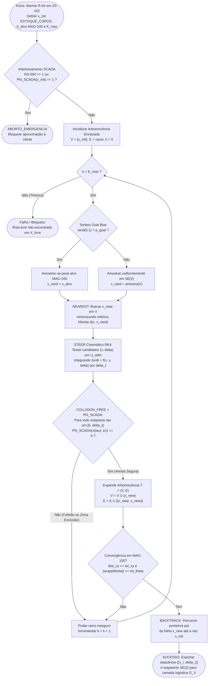

# Aula 22 — Rapidly-exploring Random Trees (RRT)

**UNIFEI • ECAA08 Automática • Grupo 2**  
**Projeto:** Aqua Index — SCADA da Máquina Pneumática de Envasamento de Água em Copos  
**Escopo desta entrega:** Parecer técnico de não aplicabilidade na máquina pneumática interna + formulação e simulação de RRT cinemático em $SE(2)$ na camada logística externa ($G_V$) acionada pelo SCADA.

---

## 0. Conceito Geral de RRT

O algoritmo **Rapidly-exploring Random Trees (RRT)** é um planejador baseado em amostragem probabilística que constrói incrementalmente uma **árvore direcionada enraizada** (arborescência) $\mathcal{T} = (V, E)$ embutida em um espaço de estados contínuo $\mathcal{X}$.

Em vez de discretizar o espaço em uma grade fixa — cuja complexidade cresce exponencialmente com a dimensão ($O(k^d)$, a "maldição da dimensionalidade") e ignora restrições diferenciais de movimento —, o RRT sorteia estados-alvo no espaço, localiza o vértice existente mais próximo e expande novos ramos **integrando numericamente as equações diferenciais do sistema** sob entradas de controle fisicamente admissíveis.

A eficiência exploratória do algoritmo decorre do **Viés de Voronoi (*Voronoi Bias*)**: a probabilidade de um vértice $\mathbf{x}_{\text{near}} \in V$ ser escolhido para expansão é proporcional ao hipervolume de sua célula de Voronoi $\mathcal{V}(\mathbf{x}_{\text{near}})$. Como os nós na fronteira da árvore possuem células voltadas para grandes regiões ainda inexploradas, a amostragem aleatória "puxa" os galhos rapidamente para cobrir o espaço livre $\mathcal{X}_{\text{livre}} = \mathcal{X} \setminus \mathcal{X}_{\text{obs}}$, enquanto o *Goal Bias* ($p_{\text{goal}}$) direciona a convergência para a região alvo $\mathcal{X}_{\text{alvo}}$.

---

## 1. Parecer Técnico: Por que o RRT NÃO se Aplica à Máquina Pneumática Interna

Antes de aplicar qualquer algoritmo avançado a um sistema industrial, uma boa prática de engenharia de controle é verificar se as hipóteses matemáticas do método correspondem à física da planta. No caso do **controle interno da máquina envasadora de água em copos** modelada no Automation Studio (Setores 000 a 500), **o uso de RRT é tecnicamente inadequado e contraindicado**, pelos cinco motivos objetivos resumidos abaixo:

| Subsistema da Envasadora | Tags ISA-5.1 | Natureza Física Real | Por que o RRT NÃO se aplica |
| :--- | :--- | :--- | :--- |
| **Atuadores pneumáticos das 5 estações** | `XV-101`, `XV-201`–`XV-203`, `XV-301`–`XV-302`, `XV-401`, `XV-501`–`XV-502` | Válvulas direcionais *on/off* comandando cilindros **batente-a-batente** (fins de curso magnéticos `ZSC`/`ZSO`). | Não existe espaço contínuo de controle de posição nem controle proporcional intermediário; cada cilindro transita apenas entre dois batentes mecânicos discretos. |
| **Manipulador *pick-and-place* (Estação 3)** | `XV-301` (Cil. D: $0^\circ / 180^\circ$), `XV-302` (Cil. E: recuado/avançado), `VAC-301`, `PIT-301` | Mecanismo pneumático de **apenas 4 combinações geométricas discretas** de batente ($2 \times 2$), além do estado binário de vácuo. | Diferente de um robô articulado de 6 GDL em $\mathbb{R}^6$, não há geometria contínua a planejar nem obstáculos internos variáveis no envelope do braço. |
| **Mesa giratória indexada (Setor 000)** | `M-001`, `SE-001` | Movimento rotativo **1D sequencial indexado** por passo fixo entre estações, travado por intertravamento lógico de fins de curso. | Um único grau de liberdade discreto e unidirecional não exige exploração estocástica; o avanço é puramente condicional. |
| **Termosselagem (E4) e Dosagem (E2)** | `HT-401` / `TIT-401` ($\ge 180^\circ\text{C}$), `XV-202` (seringa $150\text{ mL}$) | Malha térmica **SISO 1D** com temporizador fixo de $2\text{ s}$ na prensa (`XV-401`) e dosagem **volumétrica fixa** pela geometria do cilindro C. | Uma malha térmica 1D usa controle termostático/PID simples, e o volume de $150\text{ mL}$ é imposto mecanicamente pelo curso do dosador. |
| **Requisito de ciclo produtivo (*takt time*)** | Ciclo global E1 $\rightarrow$ E5 | Operação industrial exige **determinismo absoluto**, repetibilidade e rastreabilidade exata do tempo de ciclo. | O RRT é um algoritmo **probabilístico**: duas execuções sem semente fixa podem produzir trajetórias e tempos distintos, o que é inaceitável para o ciclo base da envasadora. |

> **Conclusão do Parecer de Engenharia:** O controle sequencial e a verificação formal do espaço de estados interno da envasadora pneumática pertencem ao domínio dos **sistemas a eventos discretos determinísticos** — tratados pelas **proposições booleanas de intertravamento** (Etapa 1), por **Máquinas de Estados Finitos / Grafcet** (Etapa 4) e pela **Árvore de Atingibilidade em Redes de Petri (Aula 24)**, e **não** por RRT.

---

## 2. Aplicação Legítima: RRT Cinemático em $SE(2)$ na Camada Logística Externa ($G_V$) com Gatilho do SCADA

### 2.1 Declaração Explícita de Fronteira de Sistema

Em estrito alinhamento com a **Aula 18** (*Grafos de Logística de Insumos e Produtos Acabados*) e com o documento `PRODUCT.md`:

- A máquina pneumática do Automation Studio é a **célula produtiva fixa** supervisionada pelo CLP/SCADA.
- O veículo logístico interno de abastecimento (carrinho elétrico / AGV didático) pertence exclusivamente à **camada didática externa de movimentação ($G_V$)** ao redor da célula da envasadora, sobre um *layout* conceitual proposto de galpão ($16{,}0\text{ m} \times 12{,}0\text{ m}$).
- Este modelo **não** representa uma instalação física construída, **não** adiciona novas tags físicas ao CLP no Automation Studio e **não** constitui um sistema de segurança funcional certificado.

### 2.2 Integração com o SCADA: Gatilho Real do Alarme `R-04` (`ZS-102`)

Embora o planejamento de trajetória ocorra na camada logística externa ($G_V$), **o gatilho operacional nasce diretamente no supervisório Aqua Index**:

1. Na Estação 1 (`E1-DISP`), após o recuo do Cilindro A (`XV-101`), o sensor capacitivo **`ZS-102`** (proposição lógica $s_1$) verifica a presença do copo no alojamento da mesa.
2. Quando `ZS-102 == 0` após a dispensa, o SCADA dispara o alarme **`R-04` (Falta de Copo / Magazine `MAG-100` vazio)** — o mesmo evento crítico modelado nas Aulas 08, 10, 20 e 21 — e bloqueia o avanço da mesa.
3. Em resposta ao evento `R-04`, o módulo logístico solicita uma rota segura em espaço contínuo para o veículo de abastecimento partir da baia **`ESTOQUE_COPOS`** até a doca de acoplamento do magazine **`MAG-100`** (junto à Estação 1), chegando com posição **e orientação** compatíveis para acoplamento.

### 2.3 Formulação Matemática em $SE(2)$ (Veículo Não-Holonômico)

Diferente do grafo discreto da Aula 18 (que representa corredores como arestas estáticas ponderadas em metros), a manobra fina dentro da célula logística exige respeitar a **geometria do galpão**, o **raio mínimo de curva** do veículo e a **orientação final de acoplamento** em `MAG-100`.

- **Espaço de Estados Contínuo ($\mathcal{X} \subset SE(2) = \mathbb{R}^2 \times (-\pi, \pi]$):**

$$\mathbf{x} = \begin{bmatrix} x \\ y \\ \theta \end{bmatrix} \in [0,\; 16] \times [0,\; 12] \times (-\pi,\; \pi]$$

onde $(x, y)$ é a posição do eixo traseiro do veículo em metros e $\theta$ é sua orientação (guinada) em radianos.

- **Modelo Cinemático de Bicicleta (Ackermann Não-Holonômico):**

$$\dot{x} = v \cos\theta, \qquad \dot{y} = v \sin\theta, \qquad \dot{\theta} = \frac{v}{L}\tan\delta$$

com entre-eixos $L = 0{,}90\text{ m}$, raio envoltório do veículo $R_v = 0{,}45\text{ m}$ e entradas de controle fisicamente limitadas a:

$$\mathbf{u} = \begin{bmatrix} v \\ \delta \end{bmatrix} \in \mathcal{U}_{\text{adm}} = [0{,}35,\; 1{,}20]\text{ m/s} \times [-0{,}60,\; +0{,}60]\text{ rad}$$

O limite de esterçamento $|\delta| \le \delta_{\max} = 0{,}60\text{ rad}$ ($\approx 34{,}4^\circ$) impõe um **raio mínimo de curva** fisicamente intransponível:

$$R_{\min} = \frac{L}{\tan\delta_{\max}} = \frac{0{,}90}{\tan(0{,}60)} \approx 1{,}32\text{ m}$$

Cada candidato de controle $\mathbf{u} = (v, \delta)$ é integrado numericamente pelo método de **Runge-Kutta de 4ª Ordem (RK4)** ao longo do passo $\Delta t = 0{,}8\text{ s}$ subdividido em $n_{\text{sub}} = 10$ subpassos contínuos ($h = 0{,}08\text{ s}$), validando segurança em todos os instantes intermediários $\tau \in [0, \Delta t]$.

- **Métrica Híbrida Ponderada em $SE(2)$ (Etapa `NEAREST`):**

$$d(\mathbf{x}_a, \mathbf{x}_b) = \sqrt{(x_a - x_b)^2 + (y_a - y_b)^2} + w_\theta \cdot \left|\operatorname{wrap}(\theta_a - \theta_b)\right|$$

onde $w_\theta = 0{,}75\text{ m/rad}$ pondera o desalinhamento angular em relação à distância euclidiana e a função de normalização angular garante a menor diferença no círculo unitário $S^1$:

$$\operatorname{wrap}(\alpha) = \big((\alpha + \pi) \bmod 2\pi\big) - \pi \in (-\pi, \pi]$$

### 2.4 Obstáculos Físicos do Galpão e Barreira Booleana SCADA ($\Phi_{\text{SCADA}}$)

Todos os obstáculos fixos e temporários são inflados pelo raio de segurança do veículo ($R_v = 0{,}45\text{ m}$) no espaço de configuração:

| Obstáculo / Região | Geometria Física no Galpão ($16\text{ m} \times 12\text{ m}$) | Papel no Cenário |
| :--- | :--- | :--- |
| **Célula da Envasadora (`MESA-001` + `E1`–`E5`)** | Disco centrado em $(8{,}0,\; 6{,}2)$, raio físico $1{,}75\text{ m}$ (efetivo $2{,}20\text{ m}$) | Área produtiva central proibida à circulação de veículos. |
| **Painel Central (`PLC-001`)** | Retângulo $[4{,}3,\; 5{,}5] \times [7{,}4,\; 8{,}8]$ | Gabinete elétrico/CLP/IHM do Setor 000. |
| **Esteira de Saída (`EST-500`)** | Retângulo $[9{,}8,\; 13{,}6] \times [4{,}5,\; 5{,}7]$ | Transporte pós-ejeção (`E5` $\rightarrow$ embalagem). |
| **Coluna / Palete Temporário (`PALETE_TEMP`)** | Retângulo $[4{,}2,\; 5{,}8] \times [2{,}5,\; 4{,}3]$ | Obstrução temporária bloqueando o corredor direto entre `ESTOQUE_COPOS` e `MAG-100`. |
| **Paredes do Galpão** | Margem $x \in [0{,}45,\; 15{,}55]$, $y \in [0{,}45,\; 11{,}55]$ | Limite físico da célula logística externa. |

Além das colisões geométricas, o planejador incorpora diretamente o intertravamento booleano de emergência vindo do supervisório (**`HS-004`**, proposição lógica $e_1$ da Etapa 1):

$$\mathcal{X}_{\text{obs}} = \left\{ \mathbf{x} \in \mathcal{X} \;\middle\vert\; \Phi_{\text{SCADA}}(\mathbf{x}, e_1) = e_1 \lor \text{colisao\_fisica}(\mathbf{x}) \lor \text{zona\_exclusao}(\mathbf{x}, e_1) = 1 \right\}$$

- **`e1` (`HS-004 == 1`):** se o botão de parada de emergência da envasadora estiver pressionado, $\Phi_{\text{SCADA}} = 1$ em todo o domínio e o planejamento é **imediatamente abortado** em estado seguro (`ABORTO_EMERGENCIA`), impedindo qualquer comando ao veículo.
- **`zona_exclusao`:** perímetro de segurança de raio $6{,}2\text{ m}$ centrado em `MESA-001` (que cobre integralmente a aproximação à célula e à doca de `MAG-100`). Quando ativo (por emergência `HS-004` ou bloqueio de manutenção na célula), nenhum ramo da árvore consegue se aproximar da envasadora.

---

## 3. Fluxograma do Ciclo RRT Integrado ao SCADA

---

## 4. Correspondência entre Primitivas do RRT e a Célula Logística Aqua Index

| Primitiva Algorítmica | Fundamento em Matemática Discreta / Controle | Papel na Camada Logística Externa ($G_V$) do Aqua Index |
| :--- | :--- | :--- |
| **`SAMPLE` (com *Goal Bias*)** | Amostragem estocástica em $SE(2)$ segundo distribuição mista $(1 - p_{\text{goal}})\mathcal{U}(\mathcal{X}) + p_{\text{goal}}\delta_{\mathbf{x}_{\text{alvo}}}$. | Explora corredores livres ao redor da envasadora pelo Viés de Voronoi enquanto direciona $15\%$ das amostras para a doca de acoplamento do `MAG-100`. |
| **`NEAREST`** | Busca do vizinho mais próximo em $V$ sob métrica ponderada $d(\mathbf{x}_a, \mathbf{x}_b) = \Vert(x,y)_a-(x,y)_b\Vert_2 + w_\theta|\operatorname{wrap}(\theta_a-\theta_b)|$. | Seleciona o nó da árvore já posicionado **e alinhado angularmente** de forma mais favorável para contornar `PALETE_TEMP`, `PLC-001` e `MESA-001`. |
| **`STEER`** | Controle cinemático de horizonte curto ($\Delta t = 0{,}8\text{ s}$) sujeito à dinâmica de bicicleta não-holonômica integrada por RK4. | Gera arcos suaves fisicamente realizáveis pelo carrinho abastecedor ($v \in [0{,}35;\; 1{,}20]\text{ m/s}$, $R_{\min} \approx 1{,}32\text{ m}$), evitando giros impossíveis no próprio eixo. |
| **`COLLISION_FREE` + $\Phi_{\text{SCADA}}$** | Verificação de invariância de conjunto $\mathbf{x}(\tau) \in \mathcal{X}_{\text{livre}},\; \forall \tau \in [0, \Delta t]$ com barreira booleana ISA-5.1. | Poda qualquer ramo que toque obstáculos inflados por $R_v = 0{,}45\text{ m}$ ou que viole o intertravamento de emergência `HS-004` ($e_1 = 1$) e sua zona de exclusão. |
| **`BACKTRACK`** | Travessia reversa única em arborescência enraizada ($\deg^-(v_0) = 0$ e $\deg^-(v) = 1,\; \forall v \neq v_0$, com $\vert E \vert = \vert V \vert - 1$). | Extrai o caminho único de `ESTOQUE_COPOS` até `MAG-100` como sequência determinística de comandos $\{(v_i, \delta_i)\}$ após o planejamento. |

---

## 5. Cenários Validados no Notebook e Propriedades de Arborescência

O notebook acompanhante ([`Aula 22 - Rapidly-exploring Random Trees - code.ipynb`](./Aula%2022%20-%20Rapidly-exploring%20Random%20Trees%20-%20code.ipynb)) implementa integralmente o núcleo RRT $SE(2)$ com semente determinística (`seed = 2026`), verificador independente de arborescência enraizada e suporte opcional a `networkx` e `matplotlib`, validando dois cenários operacionais principais com asserções automatizadas:

1. **Cenário 1 — Reabastecimento Nominal após Alarme `R-04` (`ZS-102 == 0`, `HS-004 == 0`):**
   - Origem em `ESTOQUE_COPOS` $(1{,}60\text{ m};\; 1{,}80\text{ m};\; 0{,}0^\circ)$ até a doca `MAG-100` $(13{,}20\text{ m};\; 9{,}60\text{ m};\; 0{,}0^\circ)$ com tolerâncias $\Delta_{xy} \le 0{,}45\text{ m}$ e $|\Delta\theta| \le 0{,}35\text{ rad}$ ($\approx 20^\circ$).
   - **Manobra ingênua em linha reta:** colide frontalmente com o palete temporário (`PALETE_TEMP`) e invade a célula da envasadora (`MESA-001` + `E1`–`E5`).
   - **Planejador RRT $SE(2)$:** encontra trajetória contínua segura em $\sim 1\text{ s}$ contornando pelo corredor oeste e corredor norte (acima de `PLC-001` e `MESA-001`), mantendo $\Phi_{\text{SCADA}} = 0$ em 100% dos subpassos RK4 e preservando rigorosamente as invariantes de árvore direcionada enraizada ($\vert E \vert = \vert V \vert - 1$, aciclicidade, grau de entrada 0 na raiz e 1 nos demais vértices).
2. **Cenário 2 — Intertravamento SCADA Ativo (`HS-004 == 1` / Zona de Exclusão da Célula):**
   - **Caso 2A (Parada de Emergência Global `HS-004 == 1`):** $\Phi_{\text{SCADA}} = 1$ já no instante inicial aborta imediatamente o planejamento (`SUCESSO = False`, `status = ABORTO_EMERGENCIA`), garantindo que nenhum movimento seja autorizado com emergência acionada na envasadora.
   - **Caso 2B (Zona de Exclusão Perimetral da Célula ativa):** mesmo permitindo circulação longe da máquina, todos os ramos que tentam cruzar o perímetro de segurança ao redor de `MESA-001` / `MAG-100` são podados por `zona_exclusao == 1`, impedindo o acoplamento enquanto a célula estiver bloqueada.

### Limitações Didáticas e Extensões

- O RRT clássico garante **completude probabilística**, mas não otimalidade de comprimento ou suavidade; uma extensão natural é o **RRT\*** (com etapa de *rewiring*) ou suavização pós-processamento por curvas de Dubins/Reeds-Shepp.
- Conforme os princípios do projeto **Aqua Index**, o *layout* do galpão e os parâmetros do carrinho abastecedor são hipóteses didáticas para conectar a disciplina de Matemática Discreta (Árvores) ao cenário logístico da Aula 18 e aos alarmes reais do SCADA.

---

## 6. Referências e Rastreabilidade no Projeto

1. LAVALLE, S. M. **Planning Algorithms**. Cambridge University Press, 2006 (Cap. 5 e Cap. 14 — *Sampling-Based Motion Planning & Kinodynamic RRT*).
2. ANSI/ISA-5.1-2009. **Instrumentation Symbols and Identification**. International Society of Automation, 2009.
3. Grupo 2 — `README.md` e `etapa-01-logica/02 - Mapeamento_de_variaveis.md` (Tags ISA-5.1, `ZS-102`, `HS-004` e descrição das estações E1–E5).
4. Grupo 2 — `etapa-02-grafos/18 - Grafos de Logistica de Insumos e Produtos Acabados.md` (Separação formal entre camada de materiais $G_M$ e camada externa de veículos $G_V$).
5. Grupo 2 — `etapa-03-arvores/Aula 20 - Algortimo de Huffman.md` (Telemetria do alarme `R-04` associado a `ZS-102`).
