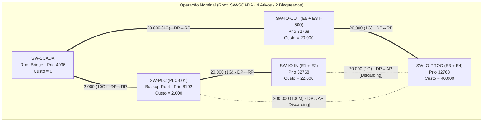

# Protocolo de Árvore Geradora (STP / RSTP) na Rede SCADA — Aqua Index

**Redundância de Camada 2 (IEEE 802.1D / 802.1w) para Supervisão e Remotas de I/O da Envasadora Pneumática**

| Especificação Técnica | Detalhes |
| :--- | :--- |
| **Unidade Industrial** | Máquina Pneumática de Envasamento de Água em Copos — **Aqua Index** (Setores 000 a 500) |
| **Camada Modelada** | Rede Ethernet Industrial L2 (PROFINET / Modbus TCP) — Supervisório SCADA e Remotas de I/O |
| **Algoritmo / Norma** | *Spanning Tree Protocol* (IEEE 802.1D) e *Rapid Spanning Tree Protocol* (IEEE 802.1w) |
| **Status do Documento** | Estudo conceitual e simulado — sem implantação física concluída (`PRODUCT.md`) |

---

## 1. Contextualização Arquitetural e Fronteira de Aplicabilidade

No projeto **Aqua Index**, o sistema supervisório opera em arquitetura **Cliente-Servidor** entre a estação **SCADA** (monitoramento, historiador e interface de operação) e o **Processo** (lógica da mesa giratória indexada com cinco estações — `E1` Dispensa, `E2` Envase, `E3` Tampa, `E4` Termosselagem e `E5` Ejeção — mais a esteira de saída `EST-500`).

> **Nota de honestidade técnica (fronteira do modelo):**
> Na simulação didática local no **Automation Studio**, a comunicação Cliente-Servidor ocorre por enlace direto ponto-a-ponto, onde não existem múltiplos switches nem ciclos físicos de Camada 2. Além disso, os **45 sensores e atuadores pneumáticos** catalogados em `02 - Mapeamento_de_variaveis.md` (`XV-101` a `XV-502`, `ZS-*`, `ZSC-*`, `PIT-301`, `TIT-401`) são sinais discretos/analógicos de campo — **não** falam Ethernet nem trocam BPDUs.
>
> Contudo, em uma implantação industrial real da célula **Aqua Index**, é prática consolidada agrupar esses sinais de campo em **módulos de I/O remoto com switch Ethernet L2 gerenciável integrado**, interligados em **anel físico redundante** até o painel do CLP (`PLC-001`) e a estação **SCADA**. É exatamente nessa camada de rede industrial que o protocolo **STP / RSTP** atua para garantir alta disponibilidade sem *loops* de quadros.

### Topologia de Switches e Remotas de I/O da Célula Aqua Index

| Nó (`Switch`) | Papel Físico na Célula | Sinais / Equipamentos Agregados (ISA-5.1) | Bridge Priority | MAC Address |
| :--- | :--- | :--- | :---: | :--- |
| **`SW-SCADA`** | Estação de Supervisão & Historiador (**Root Bridge Primário**) | Cliente SCADA, Historiador AVL (Aula 21), IHM Central | `4096` | `00:1A:2B:02:00:01` |
| **`SW-PLC`** | Painel Central `PLC-001` (**Root Bridge Secundário**) | CLP principal, Servodrive `M-001`, Encoder `SE-001`, Painel `HS-001..005` | `8192` | `00:1A:2B:02:00:02` |
| **`SW-IO-IN`** | Remota de I/O — Lado Entrada (`E1` + `E2`) | `XV-101`, `ZSC/ZSO-101`, `ZS-102`, `ZS-200`, `XV-201..203`, `ZSC-201..203` | `32768` | `00:1A:2B:02:00:03` |
| **`SW-IO-PROC`** | Remota de I/O — Lado Processo (`E3` + `E4`) | `ZS-300`, `XV-301/302`, `VAC-301`, `PIT-301`, `ZS-400`, `XV-401`, `ZSC/ZSO-401`, `HT-401`, `TIT-401` | `32768` | `00:1A:2B:02:00:04` |
| **`SW-IO-OUT`** | Remota de I/O — Lado Saída (`E5` + `EST-500`) | `ZS-500`, `XV-501/502`, `ZSC/ZSO-501..502`, Motor Esteira `M-002`, IHM Local | `32768` | `00:1A:2B:02:00:05` |

---

## 2. Fundamentação em Matemática Discreta (Teoria dos Grafos)

A infraestrutura física de switches gerenciáveis da célula é modelada como um grafo não direcionado, conexo e ponderado $G = (V, E, w)$:

* **Conjunto de Vértices ($V$):**
  $$V = \{\text{SW-SCADA},\; \text{SW-PLC},\; \text{SW-IO-IN},\; \text{SW-IO-PROC},\; \text{SW-IO-OUT}\}, \quad |V| = 5$$
* **Conjunto de Arestas ($E$):** 6 enlaces físicos redundantes — um anel principal de 5 enlaces em fibra/cabo industrial mais 1 enlace cruzado de cobre *backup* entre `SW-PLC` e `SW-IO-PROC` ($|E| = 6$).
* **Número Ciclomático:** O grafo contém exatamente $|E| - |V| + 1 = 6 - 5 + 1 = 2$ ciclos independentes.
* **Função de Peso ($w: E \to \mathbb{R}^+$):** Custo de Caminho (*Path Cost*) definido pela norma **IEEE 802.1w (RSTP)**, inversamente proporcional à largura de banda nominal do enlace:

| Velocidade do Enlace Industrial | Custo IEEE 802.1w (RSTP) | Aplicação na Célula Aqua Index |
| :--- | :---: | :--- |
| **$10\text{ Gbps}$** (10G Ethernet) | `2.000` | Backbone dedicado entre `SW-SCADA` e `SW-PLC` |
| **$1\text{ Gbps}$** (Gigabit Ethernet) | `20.000` | Anel industrial entre `SW-SCADA`, `SW-PLC` e remotas `SW-IO-*` |
| **$100\text{ Mbps}$** (Fast Ethernet) | `200.000` | Enlace cruzado de contingência (cabo cobre blindado `SW-PLC` $\leftrightarrow$ `SW-IO-PROC`) |

### 2.1. O Problema dos Ciclos na Camada 2 (Ethernet)

Quadros Ethernet IEEE 802.3 (Camada 2) **não possuem campo TTL (*Time-To-Live*)**. Se todos os 6 enlaces de $G$ permanecessem encaminhando tráfego simultaneamente, qualquer quadro de *broadcast* (como requisições ARP ou descoberta de dispositivos de I/O) circularia indefinidamente pelos dois ciclos do grafo, provocando:

1. **Tempestade de Broadcast (*Broadcast Storm*):** saturação imediata de $100\%$ da banda, travando a comunicação Cliente-Servidor entre o SCADA e o `PLC-001`.
2. **Instabilidade da Tabela MAC (*MAC Flapping*):** o endereço MAC do `PLC-001` ou de uma remota de I/O passa a ser aprendido alternadamente em portas distintas, corrompendo o encaminhamento de *frames* de telemetria.

### 2.2. Solução Formal: Árvore Geradora Lógica ($T$)

O protocolo **RSTP** executa de forma distribuída (via troca de quadros **BPDU**) a construção de uma **Árvore Geradora de Caminhos Mínimos até a Raiz** $T = (V, E_T) \subseteq G$, satisfazendo simultaneamente:

1. $V_T = V$ (todos os 5 nós permanecem alcançáveis pelo SCADA);
2. $T$ é **conexo** e **acíclico**, logo $|E_T| = |V| - 1 = 4$ enlaces ativos (*Forwarding*);
3. Os $|E| - |E_T| = 2$ enlaces redundantes permanecem logicamente bloqueados em estado **Discarding** (*Alternate Port*), prontos para assumir imediatamente em caso de rompimento físico (*Link Down*).

---

## 3. Comparativo Técnico: STP (802.1D) vs. RSTP (802.1w) no *Takt* da Envasadora

Na **Aqua Index**, o tempo de ciclo nominal (*takt time*) documentado na Etapa 02 (`Aula 12`) é de aproximadamente **$3{,}6\text{ s/copo}$** (cerca de 16–17 copos/minuto), com janela de termosselagem de $2{,}0\text{ s}$ em `E4`. O tempo de convergência da rede após um rompimento de cabo determina diretamente quantos ciclos o operador fica sem visibilidade SCADA:

| Critério Técnico | STP Clássico (IEEE 802.1D) | RSTP (IEEE 802.1w) — Recomendado | Impacto Operacional na Aqua Index |
| :--- | :--- | :--- | :--- |
| **Tempo de Convergência** | $30\text{ s}$ a $50\text{ s}$ | **$< 1\text{ s}$** (típico: $50\text{ ms}$ a $200\text{ ms}$) | No STP, $30\text{–}50\text{ s}$ equivalem a **8 a 14 ciclos completos de envase** sem supervisão SCADA, disparando *timeout* de *watchdog*. No RSTP, a reconvergência ocorre em **0 ciclos perdidos** ($< 6\%$ de um único ciclo). |
| **Estados de Porta** | 5 estados (*Disabled, Blocking, Listening, Learning, Forwarding*) | 3 estados (*Discarding, Learning, Forwarding*) | Elimina os temporizadores passivos de *Forward Delay* ($2 \times 15\text{ s}$) por meio do *handshake* ativo *Proposal/Agreement*. |
| **Papéis de Porta** | *Root, Designated, Non-Designated* | *Root (RP), Designated (DP), Alternate (AP), Backup (BP)* | A porta *Alternate* já conhece a rota alternativa para o `SW-SCADA` e transita instantaneamente para *Forwarding*. |
| **Geração de BPDUs** | Apenas o *Root Bridge* gera; demais repassam | Todos os switches geram BPDUs a cada *Hello Time* ($2\text{ s}$) | Falhas de enlace vizinho são detectadas por perda física de portadora (*Link Down*) ou em até $3 \times \text{Hello Time}$ ($6\text{ s}$). |

---

## 4. Arquitetura Lógica, Reconvergência e Proteções de Borda

### 4.1. Topologia Nominal vs. Reconvergência Após Falha no Backbone

* **Operação Nominal:** O `SW-SCADA` vence a eleição por possuir o menor `BID = (4096, 00:1A:2B:02:00:01)`. Os dois ciclos são quebrados com o bloqueio (*Alternate Port / Discarding*) das portas em `SW-IO-PROC` nos enlaces `SW-IO-IN ↔ SW-IO-PROC` (custo `20.000`) e `SW-PLC ↔ SW-IO-PROC` (custo `200.000`).
* **Cenário de Falha 1 (Rompimento do Backbone `SW-SCADA ↔ SW-PLC`):** O enlace de $10\text{ Gbps}$ cai (*Link Down*). Em menos de $1\text{ s}$, o RSTP promove a porta *Alternate* entre `SW-IO-PROC` e `SW-IO-IN` para *Forwarding*. O tráfego do `PLC-001` passa a fluir pelo caminho `SW-PLC → SW-IO-IN → SW-IO-PROC → SW-IO-OUT → SW-SCADA` (novo custo `80.000`), mantendo o enlace cobre de `200.000` bloqueado para preservar a aciclicidade ($|E_T| = 4$).
* **Cenário de Falha 2 (Queda Total do `SW-SCADA`):** Com a perda do switch central de supervisão, o **`SW-PLC`** (`Priority = 8192`) assume deterministicamente como novo *Root Bridge*, mantendo a comunicação interna entre o CLP e as remotas `SW-IO-IN`, `SW-IO-PROC` e `SW-IO-OUT` estável e livre de ciclos ($|V| = 4$, $|E_T| = 3$).

### 4.2. Proteções de Borda na Célula Industrial

* **PortFast / Edge Port:** Ativado somente nas portas de acesso conectadas ao CLP `PLC-001`, IHMs locais e notebook de manutenção, evitando atrasos de inicialização e geração desnecessária de *Topology Change Notifications* (TCNs).
* **BPDU Guard:** Habilitado nas *Edge Ports*. Caso um cabo de manutenção seja conectado inadvertidamente em *loop* no painel da envasadora, a porta entra em *err-disabled*, isolando a falha sem derrubar o anel da célula.
* **Root Guard:** Ativado nas portas de distribuição de `SW-SCADA` e `SW-PLC`, impedindo que um switch temporário com prioridade menor sequestre o papel de *Root Bridge*.

---

## 5. Independência da Segurança Física (`HS-004`) e Limites do Modelo

Em alinhamento estrito com as Aulas 04, 09, 21 e o documento [PRODUCT.md](../PRODUCT.md):

1. **Segurança física fora da camada Ethernet:** Embora o RSTP aumente a disponibilidade da supervisão SCADA e da comunicação com remotas de I/O, o acionamento do botão de emergência físico **`HS-004` (`e1`)**, o corte de alimentação do servomotor `M-001` e da resistência `HT-401`, bem como a despressurização pneumática de segurança devem operar em **malha *hardwired* dedicada** (contatos secos NF / relé de segurança), nunca dependendo exclusivamente de pacotes Ethernet.
2. **Escopo didático:** Os custos IEEE 802.1w, prioridades e cenários de falha são simulados computacionalmente no notebook acompanhante (`Aula 23 - Protocolo de Árvore Geradora (STP RSTP) - code.ipynb`) e não representam rede instalada nem certificação industrial SIL.

---

## 6. Referências Técnicas

1. IEEE Std 802.1w-2001 / IEEE 802.1D-2004 — *Rapid Reconfiguration of Spanning Tree (RSTP)*.
2. CORMEN, T. H. et al. **Algoritmos: Teoria e Prática**. 3. ed. Rio de Janeiro: Elsevier, 2012.
3. Documentação do Projeto **Aqua Index** — `README.md`, `etapa-01-logica/02 - Mapeamento_de_variaveis.md` e `etapa-03-arvores/Aula 19 - Algoritmo de Kruskal e Prim.md`.
