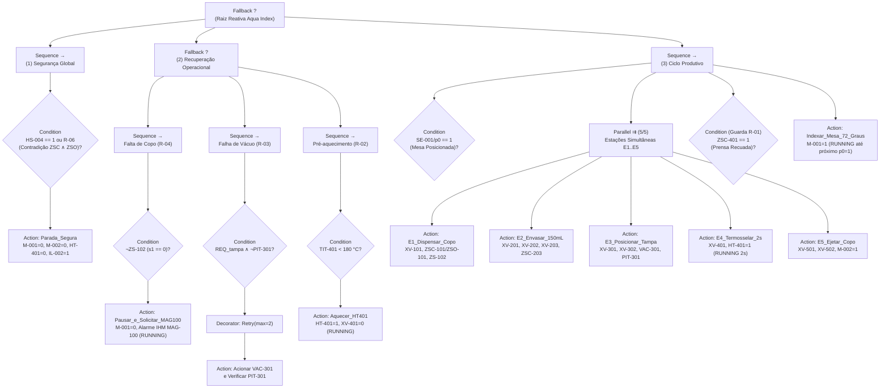

  <h2>Universidade Federal de Itajubá (UNIFEI)</h2>
  
Engenharia de Controle e Automação | Disciplina: Automática (ECAA08)

  
Projeto: SCADA — Máquina Pneumática de Envasamento de Água em Copos (Aqua Index)

  

# Aula 25 — Árvores de Comportamento (*Behavior Trees*) no SCADA Aqua Index

**Orquestração Reativa Multi-Tick da Envasadora Rotativa com Preempção por Segurança, Recuperação de Falhas e Paralelismo das Estações E1–E5**

### Informações do Projeto

| Especificação Técnica | Detalhes |
| :--- | :--- |
| **Unidade Operacional** | Máquina Pneumática de Envasamento de Água em Copos — **Aqua Index** (Setores 000 a 500) |
| **Domínio de Engenharia** | Automação Industrial, Controle Reativo, Arquiteturas de Decisão e Supervisão SCADA |
| **Estrutura de Controle** | Árvore de Comportamento (*Behavior Tree* — BT) Reativa com Nós Compostos, Decoradores e Folhas |
| **Escopo e Natureza** | Modelo conceitual e simulado de caráter acadêmico/didático (ECAA08 — Grupo 2) |
| **Código de Verificação** | [`Aula 25 - Árvores de Comportamento - code.ipynb`](Aula%2025%20-%20Árvores%20de%20Comportamento%20-%20code.ipynb) |

> **Nota de Escopo Conceitual e Segurança:** Em conformidade com a definição do projeto **Aqua Index**, toda a modelagem descrita neste documento é conceitual e voltada à simulação didática (Automation Studio $\leftrightarrow$ SCADA). O sistema não corresponde a uma máquina física construída nem reivindica certificação de segurança funcional segundo a norma IEC 61508 / IEC 61511 (SIL). Em uma planta física, o botão de emergência `HS-004` atua primariamente por circuito elétrico *hardwired* de parada segura, sendo espelhado no SCADA apenas para supervisão e intertravamento lógico complementar.

---

## 1. Fundamentação Formal de Árvores de Comportamento (*Behavior Trees*)

Uma **Árvore de Comportamento** (*Behavior Tree* — BT) é uma estrutura hierárquica orientada acíclica $T = (V, E, r)$ que modela a execução reativa e modular de tarefas discretas e temporizadas em sistemas autônomos e industriais. Diferentemente de uma árvore de decisão combinacional estática, cada nó de uma BT é ativado periodicamente por um pulso de varredura chamado ***tick*** (com período $\Delta t_{\text{tick}}$) e retorna um dentre **três estados possíveis**:

$$\mathcal{S} = \{\texttt{SUCCESS},\; \texttt{FAILURE},\; \texttt{RUNNING}\}$$

| Estado Retornado | Significado Formal | Semântica de Controle na Envasadora |
| :--- | :--- | :--- |
| `SUCCESS` | O nó atingiu seu objetivo ou a condição avaliada é verdadeira. | Etapa concluída (ex.: copo presente `ZS-102 == 1`, selagem de $2\text{ s}$ finalizada, mesa indexada em $72^\circ$). |
| `FAILURE` | O nó falhou em atingir o objetivo ou a condição avaliada é falsa. | Condição não satisfeita ou falha após esgotar retentativas (ex.: `HS-004 == 0`, perda persistente de vácuo `PIT-301`). |
| `RUNNING` | A execução está em andamento e requer múltiplos *ticks* para concluir. | Ação física temporizada ou contínua em progresso (ex.: aquecimento `HT-401`, selagem de $2\text{ s}$ em E4, giro da mesa `M-001`). |

### 1.1 Taxonomia de Nós: Controle de Fluxo, Decoradores e Folhas

#### A. Nós Compostos (*Control Flow Nodes*)

1. **Fallback / Selector (`?`):** Avalia os filhos $c_1, c_2, \dots, c_n$ da esquerda para a direita. Retorna imediatamente `SUCCESS` ou `RUNNING` no primeiro filho que não retornar `FAILURE`. Só retorna `FAILURE` se **todos** os filhos retornarem `FAILURE`:
   $$\text{Fallback}(c_1, \dots, c_n) = \begin{cases} \texttt{SUCCESS}, & \text{se } \exists i : c_i = \texttt{SUCCESS} \land \forall j < i,\; c_j = \texttt{FAILURE} \\ \texttt{RUNNING}, & \text{se } \exists i : c_i = \texttt{RUNNING} \land \forall j < i,\; c_j = \texttt{FAILURE} \\ \texttt{FAILURE}, & \text{se } \forall i \in \{1,\dots,n\},\; c_i = \texttt{FAILURE} \end{cases}$$
   Em termos industriais, o `Fallback ?` implementa **prioridade estrita por ramo** (segurança $\succ$ recuperação $\succ$ produção).

2. **Sequence (`→`):** Avalia os filhos $c_1, c_2, \dots, c_n$ da esquerda para a direita. Retorna imediatamente `FAILURE` ou `RUNNING` no primeiro filho que não retornar `SUCCESS`. Só retorna `SUCCESS` quando **todos** os filhos retornarem `SUCCESS`:
   $$\text{Sequence}(c_1, \dots, c_n) = \begin{cases} \texttt{FAILURE}, & \text{se } \exists i : c_i = \texttt{FAILURE} \land \forall j < i,\; c_j = \texttt{SUCCESS} \\ \texttt{RUNNING}, & \text{se } \exists i : c_i = \texttt{RUNNING} \land \forall j < i,\; c_j = \texttt{SUCCESS} \\ \texttt{SUCCESS}, & \text{se } \forall i \in \{1,\dots,n\},\; c_i = \texttt{SUCCESS} \end{cases}$$

3. **Parallel (`⇉`, política $M$-de-$N$):** Dispara o *tick* em todos os $N$ filhos simultaneamente no mesmo ciclo, agregando os resultados segundo o limiar $M \in \{1, \dots, N\}$:
   $$\text{Parallel}_{M/N}(c_1, \dots, c_N) = \begin{cases} \texttt{SUCCESS}, & \text{se } |\{i : c_i = \texttt{SUCCESS}\}| \ge M \\ \texttt{FAILURE}, & \text{se } |\{i : c_i = \texttt{FAILURE}\}| > N - M \\ \texttt{RUNNING}, & \text{caso contrário} \end{cases}$$
   Na mesa rotativa **Aqua Index**, as 5 estações (`E1` a `E5`) operam simultaneamente sobre 5 alojamentos distintos a cada parada da mesa; utiliza-se `Parallel(M=5, N=5)` (*RequireAll*).

#### B. Nós Decoradores (*Decorators* — aridade 1)

* **`Retry(max=k)`:** Reexecuta o nó filho quando este retorna `FAILURE`, até o limite de $k$ retentativas (totalizando até $k + 1$ execuções). Propaga `SUCCESS` e `RUNNING` normalmente; retorna `FAILURE` somente após esgotar as $k$ retentativas.
* **`Inverter` (`!`):** Inverte a polaridade lógica do filho (`SUCCESS` $\leftrightarrow$ `FAILURE`), preservando `RUNNING`.
* **`Timeout(max_ticks)`:** Impõe limite superior de duração a uma ação contínua. Se o filho permanecer em `RUNNING` por mais de `max_ticks` ciclos sem concluir, interrompe-o (`halt()`) e retorna `FAILURE`.

#### C. Nós de Execução (*Leaf Nodes*)

* **`Condition`:** Predicado *stateless* sobre variáveis ISA-5.1 e estado de processo. Retorna exclusivamente `SUCCESS` ou `FAILURE` (nunca `RUNNING`).
* **`Action`:** Comando sobre atuadores (`M-001`, `HT-401`, `VAC-301`, `XV-101..XV-502`) ou temporizadores de processo. Pode retornar `SUCCESS`, `FAILURE` ou `RUNNING` (mantendo estado interno entre *ticks* e respondendo a `halt()` em caso de preempção).

### 1.2 Behavior Tree Reativa vs. BDT Combinacional (Aula 21) vs. FSMs Monolíticas

Na **Aula 21**, a Árvore Binária de Decisão (BDT) resolveu a **arbitragem combinacional de intertravamentos** em $\mathcal{O}(h)$ para uma varredura instantânea. No entanto, o controle sequencial e multi-estação da envasadora exige estado temporal, retentativas e preempção contínua. A tabela abaixo contrasta as três abordagens:

| Critério de Engenharia | BDT Combinacional *Stateless* (Aula 21) | FSM Monolítica (Etapa 01 / Seção 6) | Behavior Tree Reativa (Aula 25) |
| :--- | :--- | :--- | :--- |
| **Domínio de Retorno** | Folha de ação booleana / alarme instantâneo | Estado ativo $q \in Q$ + saída | Tri-valorado: `SUCCESS`, `FAILURE`, `RUNNING` |
| **Persistência Temporal** | *Stateless* (sem memória entre varreduras) | Memória implícita no estado $q(t)$ | Nativa via estado `RUNNING`, `Timeout` e `Retry` |
| **Preempção por Segurança** | Avaliada a cada varredura, mas não interrompe rotinas multi-tick por si só | Exige arestas explícitas de todos os $|Q|$ estados para o estado de emergência ($\mathcal{O}(\|Q\|)$ arestas) | Estrutural: ramo esquerdo da raiz `Fallback ?` reavaliado todo *tick*, acionando `halt()` imediato no ramo `RUNNING` |
| **Modularidade e Escalabilidade** | Cresce em profundidade para novos predicados; não compõe sequências | Explosão quadrática de transições ($\mathcal{O}(\|Q\|^2)$) ao acoplar E1–E5 + recuperação | Alta modularidade: subárvores independentes compostas por `?`, `→` e `⇉` sem acoplamento cruzado |
| **Papel na Aqua Index** | Arbitragem rápida de intertravamentos e barramento paralelo de alarmes | Descrição base de passos individuais por estágio | **Orquestrador reativo global**: segurança, recuperação local (`MAG-100`, `VAC-301`, `HT-401`) e ciclo `E1..E5` |

---

## 2. Modelagem da Behavior Tree Reativa da Envasadora Aqua Index

A BT reativa da **Aqua Index** é avaliada a partir da raiz **`Fallback ?`** a cada *tick* ($\Delta t_{\text{tick}} = 0{,}5\text{ s}$ na simulação de referência). Como os ramos são avaliados sempre da esquerda para a direita a partir da raiz, qualquer evento crítico em **(1) Segurança Global** interrompe (*preempts*) imediatamente ações em curso em **(2) Recuperação Operacional** ou **(3) Ciclo Produtivo**.

### 2.1 Diagrama de Arquitetura da Behavior Tree (Mermaid)

### 2.2 Mapeamento Completo dos Nós com Tags ISA-5.1 Reais

| Subárvore / Ramo | Tipo de Nó | Regra Ref. | Tags ISA-5.1 Envolvidas | Condição / Comportamento | Retorno Típico |
| :--- | :--- | :---: | :--- | :--- | :--- |
| **Raiz** | `Fallback (?)` | Global | — | Arbitra prioridade estrita: Segurança $\succ$ Recuperação $\succ$ Produção | Estado do ramo ativo |
| **(1) Segurança Global** | `Condition` | Emergência / `R-06` | `HS-004` ($e_1$), pares `ZSC-x`/`ZSO-x` | Verdadeiro se $e_1 = 1$ ou $\bigvee_k (c_{k,a} \land c_{k,r})$ | `SUCCESS` / `FAILURE` |
| **(1) `Parada_Segura`** | `Action` | Emergência / `R-06` | `M-001`, `M-002`, `HT-401`, `IL-002` | Comanda `M-001=0`, `M-002=0`, `HT-401=0`, `IL-002=1` | `SUCCESS` (seguro) |
| **(2a) Falta de Copo** | `Condition` + `Action` | `R-04` | `ZS-102` ($s_1$), `M-001` | Se $\neg s_1$: executa `Pausar_e_Solicitar_MAG100` (`M-001=0`) | `RUNNING` até repor copo |
| **(2b) Falha de Vácuo** | `Condition` + `Retry(2)` + `Action` | `R-03` | `VAC-301` ($v_7$), `PIT-301` ($p_1$) | Se $\text{REQ\_tampa} \land \neg p_1$: tenta até $2$ retentativas em `VAC-301` | `RUNNING` / `SUCCESS` / `FAILURE` |
| **(2c) Pré-aquecimento** | `Condition` + `Action` | `R-02` | `TIT-401` ($t_1$), `HT-401` ($h_1$), `XV-401` | Enquanto `TIT-401 < 180°C`: mantém `HT-401=1`, `XV-401=0` | `RUNNING` até $\ge 180^\circ\text{C}$ |
| **(3a) Mesa Posicionada** | `Condition` | Sincronismo | `SE-001` ($p_0$) | Verifica se `SE-001/p0 == 1` (mesa parada no ângulo nominal) | `SUCCESS` / `FAILURE` |
| **(3b) Estações E1–E5** | `Parallel (5/5)` | Ciclo `E1..E5` | `XV-101..502`, `ZSC-203`, `PIT-301`, `M-002` | Executa `E1`..`E5` em paralelo; `E4` mantém calor/pressão por $2\text{ s}$ | `RUNNING` (2s) $\to$ `SUCCESS` |
| **(3c) Guarda Anti-Colisão** | `Condition` | `R-01` | `ZSC-401` ($c_{7r}$) | Exige prensa recuada (`ZSC-401 == 1`) antes de girar a mesa | `SUCCESS` / `FAILURE` |
| **(3d) Indexação da Mesa** | `Action` | Avanço $72^\circ$ | `M-001` ($m_0$), `SE-001` ($p_0$) | Liga `M-001=1` até completar passo de $72^\circ$ e confirmar `p0=1` | `RUNNING` $\to$ `SUCCESS` |

---

## 3. Verificação Computacional em Python 3.13

O notebook [`Aula 25 - Árvores de Comportamento - code.ipynb`](Aula%2025%20-%20Árvores%20de%20Comportamento%20-%20code.ipynb) implementa o motor completo de *Behavior Trees* (`Status`, `Fallback`, `Sequence`, `Parallel`, `Retry`, `Inverter`, `Timeout`, `Condition`, `Action`) acoplado a uma planta simulada **Aqua Index** (`PlantaAquaIndex`) com passo $\Delta t_{\text{tick}} = 0{,}5\text{ s}$, validando por meio de `assert`s determinísticos:

1. **Cenário 1 — Ciclo Nominal:** Execução paralela de `E1..E5` com temporizador de selagem de $2{,}0\text{ s}$ em `E4` (`RUNNING` durante os ticks de selagem), validação da guarda anti-colisão `R-01` (`ZSC-401 == 1`) e indexação de $72^\circ$ por `M-001` (`RUNNING` $\to$ `SUCCESS`).
2. **Cenário 2 — Pré-aquecimento `RUNNING` (`R-02`):** `TIT-401 < 180°C` retém o fluxo em `Aquecer_HT401` (`RUNNING`, `HT-401=1`, `XV-401=0`) até atingir $180^\circ\text{C}$, transitando automaticamente para o ciclo produtivo no *tick* seguinte.
3. **Cenário 3 — Recuperação `Retry(max=2)` em `PIT-301` (`R-03`):** Falha transitória de vácuo na tentativa inicial; o decorador `Retry(max=2)` reaciona `VAC-301`, confirma `PIT-301 == 1` na retentativa e evita parada desnecessária, além de validar o esgotamento após 2 retentativas quando a falha é persistente.
4. **Cenário 4 — Preempção Imediata por `HS-004`:** Acionamento de `HS-004 == 1` no meio de uma ação `RUNNING` (`E4_Termosselar_2s`); no *tick* imediato, a raiz `Fallback ?` aciona `halt()` no ramo produtivo e impõe `Parada_Segura` (`M-001=0, M-002=0, HT-401=0, IL-002=1`).
