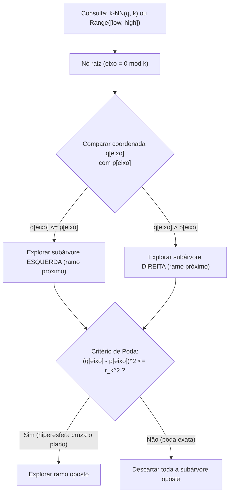

  <h2>Universidade Federal de Itajubá (UNIFEI)</h2>
  
Engenharia de Controle e Automação | Disciplina: Automática (ECAA08)

  
Projeto: SCADA — Máquina Pneumática de Envasamento de Água em Copos (Aqua Index)

  

# Aula 26 — KD-Trees (*k-Dimensional Trees*) no SCADA Aqua Index

**Particionamento Espacial Multidimensional para Historiador SCADA ($\mathbb{R}^3$) e Aceleração do Planejador RRT ($\mathbb{R}^2$)**

### Informações do Projeto

| Especificação Técnica | Detalhes |
| :--- | :--- |
| **Unidade Operacional** | Máquina Pneumática de Envasamento de Água em Copos — **Aqua Index** (Setores 000 a 500) |
| **Domínio de Engenharia** | Automação Industrial, Telemetria Multidimensional SCADA, Logística em $\mathbb{R}^2$ e Matemática Discreta |
| **Estrutura de Dados** | Árvore *k*-Dimensional (`KDTree`) com *Orthogonal Range Search* e busca $k$-NN ($k=5$) |
| **Escopo e Natureza** | Modelo conceitual e simulado de caráter acadêmico/didático (ECAA08 — Grupo 2) |
| **Código de Verificação** | [`Aula 26 - KD-Trees - code.ipynb`](Aula%2026%20-%20KD-Trees%20-%20code.ipynb) |

> **Nota de Escopo Conceitual (`PRODUCT.md`):** Em conformidade com a definição do projeto **Aqua Index**, toda a modelagem descrita neste relatório é conceitual e voltada à simulação didática (Automation Studio $\leftrightarrow$ SCADA). O sistema não corresponde a uma máquina física concluída, não adiciona novos sensores físicos ao CLP e não reivindica certificação de segurança funcional.

---

## 1. Fronteira de Engenharia Honesta: Onde a KD-Tree NÃO se Aplica e Onde Ela Brilha

Antes de adotar uma estrutura de particionamento espacial em $\mathbb{R}^k$, é dever de engenharia verificar se a natureza dos dados justifica seu uso. Na envasadora **Aqua Index**, existem domínios em que a **KD-Tree é tecnicamente inadequada**:

1. **Catálogo Estático de 45 Tags ISA-5.1:**
   * Como demonstrado na **Aula 21**, consultar metadados pelo nome da tag (ex.: `TIT-401`, `ZS-102`) é resolvido em $\mathcal{O}(1)$ por tabela *hash* (`dict`), e consultas ordenadas por faixa de setores (`200` a `400`) são resolvidas em $\mathcal{O}(\log N + K)$ por uma **Árvore AVL 1D** com chave `(setor, tag)`. Não há geometria contínua multidimensional envolvida.
2. **Atuadores Pneumáticos Binários e Fins de Curso Discretos:**
   * Os cilindros batente-a-batente (`XV-101`, `XV-201`–`XV-203`, `XV-301`–`XV-302`, `XV-401`, `XV-501`–`XV-502`) e seus respectivos pares de fins de curso magnéticos (`ZSC`/`ZSO`) operam em espaços booleanos $\{0, 1\}$. Calcular distância euclidiana entre bits discretos não possui significado físico; para esse domínio aplicam-se a **BDT Contextual (Aula 21)** e **Redes de Petri / Behavior Trees**.

### As Duas Frentes Contínuas Legítimas (Sem Inventar Nenhum Sensor Físico)

Por outro lado, a planta **Aqua Index** e sua camada logística já produzem **vetores contínuos em baixa dimensão** ($k=2$ e $k=3$) a partir exclusivamente da instrumentação existente:

| Frente de Aplicação | Espaço | Origem dos Dados (Tags Reais ISA-5.1) | Estrutura Anterior (Aulas 21–22) | Ganho com a **KD-Tree** |
| :--- | :---: | :--- | :--- | :--- |
| **Frente A — Historiador Multidimensional SCADA** | $\mathbb{R}^3$ | `[TIT-401 (°C), takt_s (derivado de SE-001), tempo_vacuo_ms (derivado de VAC-301 -> PIT-301)]` | **AVL 1D** da Aula 21 (indexa apenas o *timestamp* $\tau$) | Consultas por faixa operacional (*Orthogonal Range Search*) e diagnóstico de ciclos similares via **$k$-NN** ($k=5$). |
| **Frente B — Aceleração do `NEAREST` no RRT** | $\mathbb{R}^2$ | Posição $(x, y)$ no galpão $16{,}0\text{ m} \times 12{,}0\text{ m}$ (`ESTOQUE_COPOS` $\rightarrow$ `MAG-100`, gatilho `R-04` em `ZS-102`) | Varredura linear $\mathcal{O}(N)$ no passo `NEAREST` da Aula 22 | Poda espacial $\mathcal{O}(\log N)$ reduzindo nós visitados em até **$99{,}84\%$** para $N=15\,000$ vértices. |

---

## 2. Formalização Algorítmica da KD-Tree

Uma **KD-Tree** (Bentley, 1975) é uma árvore binária de busca que generaliza a BST 1D para pontos em $\mathbb{R}^k$, alternando a coordenada de corte (*splitting axis*) a cada nível de profundidade $d$:

$$\text{eixo}(d) = d \bmod k$$

Na construção estática balanceada por **mediana**, cada nó interno armazena um ponto $\mathbf{p} \in \mathbb{R}^k$ que particiona o subespaço atual por um hiperplano ortogonal ao eixo $a = \text{eixo}(d)$:

* Subárvore esquerda: todos os pontos com $x_a \le p_a$;
* Subárvore direita: todos os pontos com $x_a \ge p_a$.

Como cada nível divide o conjunto ao meio, a altura é garantidamente $h = \lceil \log_2(N + 1) \rceil$ e o custo de construção é $\mathcal{O}(N \log N)$ (ou $\mathcal{O}(N \log^2 N)$ usando ordenação por nível com `mergesort`).

### 2.1 *Orthogonal Range Search* e Busca $k$-NN Exata

1. ***Orthogonal Range Search* (`[low, high]`):**
   Para cada nó $\mathbf{p}$ no eixo $a$, testa-se se $\mathbf{p} \in [\mathbf{low}, \mathbf{high}]$. A descida só entra na subárvore esquerda se $\text{low}_a \le p_a$ e só entra na subárvore direita se $\text{high}_a \ge p_a$. Complexidade de pior caso em $\mathbb{R}^k$: $\mathcal{O}(N^{1 - 1/k} + K)$, onde $K$ é o número de pontos retornados.
2. **Busca $k$-NN com Fila de Prioridade (*Max-Heap*):**
   Mantém-se um *max-heap* de tamanho máximo $k$ com as $k$ menores distâncias quadradas encontradas até o momento. Após visitar o **ramo próximo** ao ponto de consulta $\mathbf{q}$, o **ramo distante** só é visitado se o heap ainda tiver menos de $k$ elementos **ou** se a distância ortogonal ao hiperplano divisor satisfizer:
   $$(q_a - p_a)^2 \le d_k^2(\mathbf{q})$$
   onde $d_k^2(\mathbf{q})$ é o quadrado da distância ao $k$-ésimo melhor candidato atual. Caso contrário, **toda a subárvore oposta é podada** sem perda de exatidão.

---

## 3. Frente A — Historiador Multidimensional SCADA em $\mathbb{R}^3$ (Complemento à AVL 1D)

Na **Aula 21**, a Árvore AVL indexa eventos pelo *timestamp* $\tau \in \mathbb{N}$ (1D), respondendo perguntas como *"o que ocorreu entre $t_1$ e $t_2$?"*. Porém, durante a Análise de Causa-Raiz (RCA), o engenheiro de automação precisa responder perguntas **multivariáveis** entre ciclos produtivos completos:

> *"Quais ciclos históricos operaram simultaneamente com temperatura de selagem dentro da janela ideal, takt nominal e resposta rápida de vácuo?"*  
> *"Dado um ciclo anômalo atual, quais foram os 5 ciclos passados mais parecidos com ele no histórico?"*

Para isso, cada ciclo produtivo indexado gera um vetor $\mathbf{x} \in \mathbb{R}^3$ derivado exclusivamente de tags ISA-5.1 já existentes no SCADA:

$$\mathbf{x}_i = \begin{bmatrix} \text{TIT-401}_i \; (^\circ\text{C}) \\ \text{takt\_s}_i \; (\text{s, derivado de } \text{SE-001}) \\ \text{tempo\_vacuo\_ms}_i \; (\text{ms, derivado de } \text{VAC-301} \rightarrow \text{PIT-301}) \end{bmatrix}$$

### 3.1 Normalização de Escala (Z-Score)

Sem normalização, a variável `tempo_vacuo_ms` ($\approx 200$–$500\text{ ms}$, $\sigma \approx 86{,}5\text{ ms}$) dominaria numericamente `takt_s` ($\approx 3{,}6$–$5{,}1\text{ s}$, $\sigma \approx 0{,}50\text{ s}$) na distância euclidiana por um fator superior a $170\times$. Por isso, antes de construir a `KDTree`, aplica-se padronização **Z-score** por eixo:

$$z_{i,j} = \frac{x_{i,j} - \mu_j}{\sigma_j}, \qquad j \in \{1, 2, 3\}$$

### 3.2 Resultados Validados no Notebook ($N = 2\,400$ Ciclos Simulados)

Na simulação determinística (`seed = 2026`) com 4 regimes operacionais (`NOMINAL`, `SELAGEM_FRIA_R02`, `VACUO_LENTO_R03` e `DEGRADACAO_MISTA`):

* **Consulta por Faixa Ortogonal** (`TIT-401` $\in [180;\; 190]^\circ\text{C}$, `takt_s` $\in [3{,}20;\; 4{,}00]\text{ s}$, `tempo_vacuo_ms` $\in [150;\; 280]\text{ ms}$):
  * Retornou **$1\,751$ ciclos** em conformidade, visitando $1\,840$ nós ($76{,}7\%$ da árvore — apenas $89$ nós além dos próprios $1\,751$ registros pertencentes à caixa), com **$100\%$ de concordância** frente à força bruta.
* **Diagnóstico $5$-NN** para o ciclo anômalo $\mathbf{q} = [177{,}5^\circ\text{C},\; 4{,}70\text{ s},\; 445{,}0\text{ ms}]$:
  * Visitou apenas **$54 / 2\,400$ nós ($2{,}2\%$ da árvore)**;
  * Recuperou os $5$ vizinhos mais próximos (todos do regime `DEGRADACAO_MISTA`, com $d_z \in [0{,}2596;\; 0{,}4322]$), com **$100\%$ de concordância** em índices e distâncias contra a busca exaustiva.

---

## 4. Frente B — Aceleração do Passo `NEAREST` do RRT da Aula 22 em $\mathbb{R}^2$

Na **Aula 22**, o planejador RRT movimenta o veículo logístico no galpão $16{,}0\text{ m} \times 12{,}0\text{ m}$ entre `ESTOQUE_COPOS` $(1{,}60;\; 1{,}80)$ e a doca `MAG-100` $(13{,}20;\; 9{,}60)$ após o alarme `R-04` (`ZS-102 == 0`). A cada iteração, a primitiva `NEAREST` busca o vértice da árvore mais próximo da amostra aleatória $\mathbf{x}_{\text{rand}}$.

Na implementação base em varredura linear $\mathcal{O}(N)$, construir uma árvore com $N$ vértices custa $\sum_{i=1}^{N} i = \mathcal{O}(N^2)$ apenas na etapa `NEAREST`. Substituindo a busca linear pela `KDTree` em $\mathbb{R}^2$ (para a projeção planar $(x, y)$ do espaço livre ao redor de `MESA-001`), o custo por consulta cai para $\mathcal{O}(\log N)$.

### Benchmark Empírico ($200$ Consultas `NEAREST` por Tamanho de Árvore)

| $N$ (Vértices RRT) | Linear $\mathcal{O}(N)$ (ms) | KD-Tree $\mathcal{O}(\log N)$ (ms) | *Speedup* | Nós KD Visitados (Média) | Redução de Nós Visitados | Concordância 1-NN |
| :---: | :---: | :---: | :---: | :---: | :---: | :---: |
| **200** | $2{,}607$ | $8{,}160$ | $0{,}32\times$ | $13{,}4$ | $93{,}30\%$ | $100\%$ |
| **1 000** | $5{,}026$ | $8{,}727$ | $0{,}58\times$ | $16{,}8$ | $98{,}32\%$ | $100\%$ |
| **5 000** | $11{,}256$ | $8{,}443$ | **$1{,}33\times$** | $22{,}4$ | $99{,}55\%$ | $100\%$ |
| **15 000** | $27{,}648$ | $10{,}455$ | **$2{,}64\times$** | $23{,}6$ | **$99{,}84\%$** | $100\%$ |

> **Observação Técnica Transparente:** Para $N \le 1\,000$ em Python puro, a busca linear vetorizada em C (`NumPy`) vence em tempo de relógio devido ao *overhead* de chamadas recursivas em Python na KD-Tree, embora a KD-Tree já visite $93\%$–$98\%$ menos nós. A partir de $N = 5\,000$ ($1{,}33\times$) e $N = 15\,000$ ($2{,}64\times$, visitando apenas $23{,}6$ nós em média contra $15\,000$), a vantagem assintótica $\mathcal{O}(\log N)$ supera o *overhead* do interpretador.

---

## 5. A Maldição da Dimensionalidade ($k \gg 20$) vs. Eficiência em $k=2$ e $k=3$

Por que não indexar todas as $45$ tags da **Aqua Index** em uma única KD-Tree em $\mathbb{R}^{45}$? A resposta está na **maldição da dimensionalidade**:

1. Em um hipercubo $[0, 1]^d$, o volume de uma hiperesfera de raio $r$ tende a zero em relação ao volume do hipercubo quando $d$ cresce, e quase todo o volume concentra-se próximo às bordas.
2. Como consequência geométrica, a distância ao vizinho mais próximo $d_1(\mathbf{q})$ fica próxima da distância até a maioria dos pontos, fazendo com que a hiperesfera de busca de raio $d_1(\mathbf{q})$ **intercepte quase todos os hiperplanos divisores** ($|q_a - p_a| \le d_1(\mathbf{q})$).
3. Na prática, quando $N \ll 2^d$ (ou simplesmente $d \ge 20$ para $N$ típico de engenharia), a regra de poda raramente dispara e a KD-Tree visita praticamente $100\%$ dos nós — degenerando para uma busca linear com custo extra de ponteiros.

### Experimento Empírico no Notebook ($N = 2\,000$ pontos, $100$ consultas 1-NN)

| Dimensão ($d$) | Nós Visitados (Média) | Fração da Árvore Visitada | Comportamento da Poda |
| :---: | :---: | :---: | :--- |
| **$d = 2$** (RRT Galpão) | $16{,}7$ | **$0{,}84\%$** | Poda altamente eficiente |
| **$d = 3$** (Historiador SCADA) | $28{,}2$ | **$1{,}41\%$** | Poda altamente eficiente |
| $d = 5$ | $99{,}0$ | $4{,}95\%$ | Poda moderada |
| $d = 10$ | $1\,299{,}0$ | $64{,}95\%$ | Degradação acentuada |
| **$d = 20$** | $1\,999{,}1$ | **$99{,}96\%$** | Colapso da poda ($\approx$ linear) |
| **$d = 30$** | $2\,000{,}0$ | **$100{,}00\%$** | Sem poda (varredura total) |
| **$d = 50$** | $2\,000{,}0$ | **$100{,}00\%$** | Sem poda (varredura total) |

Isso explica matematicamente por que a escolha de **$k=2$ (Frente B)** e **$k=3$ (Frente A)** mantém a poda na faixa de $0{,}8\%$ a $2{,}2\%$ dos nós, enquanto tentar indexar vetores de alta dimensão ($k \gg 20$) destruiria o ganho da estrutura.

---

## 6. Verificação Computacional

O notebook [`Aula 26 - KD-Trees - code.ipynb`](Aula%2026%20-%20KD-Trees%20-%20code.ipynb) foi implementado do zero em **Python 3.13 + NumPy** (sem `scipy` ou `sklearn`, com `matplotlib` opcional protegido por `try/except`) e executado integralmente com asserções automatizadas:

1. Validação $100\%$ exata de `k_nearest` ($k=1, 5$) e `range_search` contra força bruta em $\mathbb{R}^2$ e $\mathbb{R}^3$ (incluindo pontos duplicados e bordas);
2. Simulação da **Frente A** ($2\,400$ ciclos em $\mathbb{R}^3$ com normalização Z-score, *Orthogonal Range Search* e $5$-NN);
3. Benchmark da **Frente B** ($N \in \{200, 1\,000, 5\,000, 15\,000\}$ em $\mathbb{R}^2$ no galpão $16\text{ m} \times 12\text{ m}$);
4. Demonstração empírica da **Maldição da Dimensionalidade** para $d \in \{2, 3, 5, 10, 20, 30, 50\}$.

---

## 7. Referências Técnicas

1. BENTLEY, J. L. **Multidimensional binary search trees used for associative searching**. *Communications of the ACM*, v. 18, n. 9, p. 509–517, 1975.
2. FRIEDMAN, J. H.; BENTLEY, J. L.; FINKEL, R. A. **An algorithm for finding best matches in logarithmic expected time**. *ACM Transactions on Mathematical Software*, v. 3, n. 3, p. 209–226, 1977.
3. LAVALLE, S. M. **Planning Algorithms**. Cambridge University Press, 2006 (Cap. 5 — *Nearest-Neighbor Queries in RRT*).
4. Grupo 2 — `etapa-01-logica/02 - Mapeamento_de_variaveis.md`, `etapa-03-arvores/Aula 21 - Árvores Binárias.md` e `etapa-03-arvores/Aula 22 - Rapidly-exploring Random Trees.md`.
