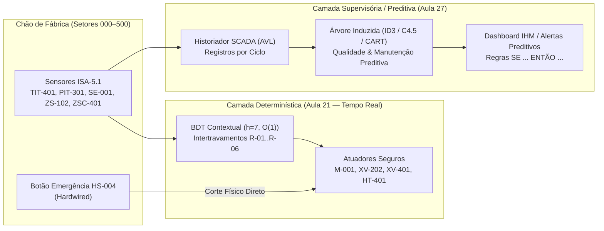

  <h2>Universidade Federal de Itajubá (UNIFEI)</h2>
  
Engenharia de Controle e Automação | Disciplina: Automática (ECAA08)

  
Projeto: SCADA — Máquina Pneumática de Envasamento de Água em Copos (Aqua Index)

  

# Aula 27 — Árvores de Decisão (ID3, C4.5 e CART) no SCADA Aqua Index

**Indução Automática de Regras para Controle de Qualidade e Manutenção Preditiva**

### Informações do Projeto

| Especificação Técnica | Detalhes |
| :--- | :--- |
| **Unidade Operacional** | Máquina Pneumática de Envasamento de Água em Copos — **Aqua Index** (Setores 000 a 500) |
| **Domínio de Engenharia** | Automação Industrial, Telemetria SCADA, Aprendizado de Máquina Supervisionado |
| **Algoritmos Abordados** | **ID3** (Ganho de Informação), **C4.5** (Razão de Ganho e limiares contínuos) e **CART** (Índice de Gini) |
| **Escopo e Natureza** | Modelo conceitual e simulado de caráter acadêmico/didático (ECAA08 — Grupo 2) |
| **Código de Verificação** | [`Aula 27 - Árvores de Decisão - ID3 C4.5 e CART - code.ipynb`](Aula%2027%20-%20Árvores%20de%20Decisão%20-%20ID3%20C4.5%20e%20CART%20-%20code.ipynb) |

> **Nota de Escopo Conceitual:** Em conformidade com a definição do projeto **Aqua Index**, toda a modelagem descrita neste relatório é conceitual e voltada à simulação didática (Automation Studio $\leftrightarrow$ SCADA). O sistema não corresponde a uma máquina física construída nem reivindica certificação de segurança funcional segundo a norma IEC 61511 / SIL.

---

## 1. Contraste Fundamental com a Aula 21: BDT Determinística vs. Árvores Induzidas (ML)

Na **Aula 21**, projetamos uma **Árvore Binária de Decisão (BDT) Contextual** para os intertravamentos da envasadora e uma **Árvore AVL** para indexar os eventos assíncronos do Historiador SCADA. Na **Aula 27**, utilizamos os dados históricos acumulados por esse mesmo Historiador para **induzir automaticamente árvores de decisão** pelos algoritmos clássicos **ID3**, **C4.5** e **CART**.

Embora ambas as abordagens resultem em estruturas de decisão hierárquicas e interpretáveis, seus papéis na arquitetura de automação industrial são **estritamente distintos e complementares**:

| Dimensão de Engenharia | BDT Contextual (Aula 21) | Árvores Induzidas: ID3 / C4.5 / CART (Aula 27) |
| :--- | :--- | :--- |
| **Origem das Regras** | Projeto determinístico manual de engenharia (FSM + regras `R-01`–`R-06`) | Indução automática a partir de dados históricos (`Historiador SCADA`) |
| **Finalidade no SCADA** | Segurança operacional, proteção de atuadores e intertravamento em tempo real | Classificação de qualidade do produto e alerta de manutenção preditiva |
| **Natureza da Decisão** | Exata e booleana ($100\%$ previsível para cada combinação de sensores) | Estatística/empírica (sujeita a generalização, ruído e erro residual) |
| **Complexidade de Inferência** | Fixa $\mathcal{O}(h) = \mathcal{O}(1)$ com altura $h = 7$ | Proporcional à profundidade induzida (`max_depth`) |
| **Substitui Segurança?** | É a camada lógica de intertravamento | **JAMAIS** substitui intertravamento determinístico nem `HS-004` *hardwired* |

> **Princípio Inegociável de Segurança Industrial:** Modelos induzidos por Aprendizado de Máquina (ID3, C4.5, CART ou qualquer outro classificador estatístico) **nunca** devem substituir a lógica determinística de intertravamento do CLP/BDT nem dispositivos físicos de parada de emergência como o botão `HS-004` (*hardwired*). O papel do ML no SCADA é **analítico e preditivo** (antecipar perda de vácuo na ventosa `PIT-301`, deriva térmica em `TIT-401` ou atrasos de indexação em `SE-001`), mantendo a camada de segurança 100% determinística.

---

## 2. Modelagem do Dataset SCADA a partir das Tags Reais (`Aqua Index`)

Para validar os algoritmos de indução em ambiente reproduzível, construiu-se um gerador sintético determinístico (`seed=2026`, $800$ ciclos de máquina) com divisão estratificada **70/30** ($560$ ciclos de treino e $240$ ciclos de teste).

### 2.1 Atributos Extraídos das Tags ISA-5.1

| Atributo no Modelo | Tag ISA-5.1 de Origem | Setor / Estação | Tipo e Unidade | Significado Operacional |
| :--- | :--- | :---: | :--- | :--- |
| `temp_TIT401_C` | `TIT-401` | Setor 400 (`E4`) | Contínuo ($^\circ\text{C}$) | Temperatura do cabeçote de termosselagem (nominal $\ge 180\,^\circ\text{C}$). |
| `tempo_prensa_E4_s` | `XV-401` / `ZSC-401` | Setor 400 (`E4`) | Contínuo ($\text{s}$) | Tempo de permanência da prensa aplicada sobre o copo (nominal $\approx 2{,}0\,\text{s}$). |
| `tempo_vacuo_PIT301_ms` | `PIT-301` | Setor 300 (`E3`) | Contínuo ($\text{ms}$) | Tempo até confirmação de sucção da tampa pelo pressostato de vácuo. |
| `desvio_takt_SE001_ms` | `SE-001` / `M-001` | Setor 000 (Mesa) | Contínuo ($\text{ms}$) | Desvio de tempo de indexação da mesa giratória em relação ao *takt* nominal. |
| `copo_ZS102` | `ZS-102` | Setor 100 (`E1`) | Discreto ($\{0, 1\}$) | Presença de copo no alojamento após dispensação (`1` = presente, `0` = ausente). |

### 2.2 Classes Operacionais de Qualidade e Diagnóstico

| ID | Classe | Total ($800$) | Treino ($560$) | Teste ($240$) | Causa Física Associada |
| :---: | :--- | :---: | :---: | :---: | :--- |
| `0` | `CICLO_CONFORME` | 400 | 280 | 120 | Todos os parâmetros nominais nas estações `E1`–`E5`. |
| `1` | `RISCO_SELAGEM_FRACA` | 152 | 106 | 46 | Cabeçote `TIT-401` frio/limítrofe ou tempo curto da prensa `XV-401` em `E4`. |
| `2` | `FALHA_TAMPA_VACUO` | 128 | 90 | 38 | Atraso/falha na confirmação do pressostato `PIT-301` (desgaste de ventosa/sucção). |
| `3` | `PARADA_ABASTECIMENTO_ATRASO` | 120 | 84 | 36 | Ausência de copo em `ZS-102` (magazine vazio) e/ou atraso severo em `SE-001`. |

---

## 3. Fundamentos Matemáticos: ID3, C4.5 e CART

Dado um conjunto de amostras $S$ com $C = 4$ classes e proporções empíricas $p_k = |S_k| / |S|$:

### 3.1 Entropia de Shannon e Ganho de Informação (ID3)

$$H(S) = -\sum_{k=1}^{C} p_k \log_2(p_k)$$

Para uma partição binária por limiar $t$ ($x_j \le t$ vs. $x_j > t$), o **Ganho de Informação** mede a redução esperada na entropia:

$$IG(S, t) = H(S) - \left(\frac{|S_{\text{esq}}|}{|S|} H(S_{\text{esq}}) + \frac{|S_{\text{dir}}|}{|S|} H(S_{\text{dir}})\right)$$

### 3.2 Razão de Ganho (C4.5)

O algoritmo **ID3** favorece atributos com muitos valores distintos (ou partições muito fragmentadas). O **C4.5** corrige esse viés normalizando o ganho pela **Informação de Divisão** (*Split Information*):

$$\text{SplitInfo}(S, t) = -\left(\frac{|S_{\text{esq}}|}{|S|}\log_2\frac{|S_{\text{esq}}|}{|S|} + \frac{|S_{\text{dir}}|}{|S|}\log_2\frac{|S_{\text{dir}}|}{|S|}\right), \qquad GR(S, t) = \frac{IG(S, t)}{\text{SplitInfo}(S, t)}$$

Além disso, o C4.5 estende o ID3 para lidar nativamente com **atributos contínuos** (como `temp_TIT401_C` e `tempo_vacuo_PIT301_ms`) avaliando limiares candidatos $t = \frac{v_i + v_{i+1}}{2}$ entre valores ordenados consecutivos.

### 3.3 Índice de Gini (CART)

O algoritmo **CART** (*Classification and Regression Trees*) constrói árvores estritamente binárias minimizando a impureza de **Gini**, que evita o cálculo de logaritmos:

$$G(S) = 1 - \sum_{k=1}^{C} p_k^2, \qquad \Delta G(S, t) = G(S) - \left(\frac{|S_{\text{esq}}|}{|S|} G(S_{\text{esq}}) + \frac{|S_{\text{dir}}|}{|S|} G(S_{\text{dir}})\right)$$

---

## 4. Resultados Experimentais e Extração de Regras (`SE ... ENTÃO ...`)

Toda a implementação foi executada do zero em **Python 3.13 + NumPy** no *notebook* da aula (`ArvoreDecisaoClassica`, sem `scikit-learn`).

### 4.1 Comparativo Gini (CART) vs. Entropia (ID3/C4.5) com `max_depth=5`, `min_samples_split=5`

| Critério | Acurácia Teste | Precisão Macro | Recall Macro | F1 Macro | Nós | Folhas |
| :--- | :---: | :---: | :---: | :---: | :---: | :---: |
| **CART (`gini`)** | **97,08%** | 95,99% | 95,96% | 95,97% | 15 | 8 |
| **ID3/C4.5 (`entropy`)** | **97,50%** | 96,57% | 96,66% | 96,60% | 17 | 9 |

#### Matriz de Confusão $4 \times 4$ — CART (`gini`, `max_depth=5`, $n = 240$)

| Real $\backslash$ Predito | `C0` Conforme | `C1` Selagem | `C2` Vácuo | `C3` Abast./Atraso |
| :--- | :---: | :---: | :---: | :---: |
| **`C0` `CICLO_CONFORME`** | **119** | 0 | 1 | 0 |
| **`C1` `RISCO_SELAGEM_FRACA`** | 1 | **44** | 0 | 1 |
| **`C2` `FALHA_TAMPA_VACUO`** | 0 | 0 | **37** | 1 |
| **`C3` `PARADA_ABASTECIMENTO_ATRASO`** | 0 | 2 | 1 | **33** |

#### Comparativo de Critérios no Nó Raiz ($560$ ciclos de treino)

| Atributo | Limiar Ótimo | `IG` (ID3) | `GainRatio` (C4.5) | $\Delta\text{Gini}$ (CART) |
| :--- | :---: | :---: | :---: | :---: |
| `tempo_vacuo_PIT301_ms` | `259,90 ms` | **0,6201** | **0,9622** | **0,1908** |
| `desvio_takt_SE001_ms` | `62,44 ms` | 0,5012 | 0,8407 | 0,1612 |
| `copo_ZS102` | `0,50` | 0,3463 | 0,7212 | 0,1195 |
| `temp_TIT401_C` | `180,44 °C` | 0,2481 | 0,5041 | 0,0946 |
| `tempo_prensa_E4_s` | `1,76 s` | 0,2391 | 0,5335 | 0,0900 |

### 4.2 Regras Legíveis Extraídas para Supervisão SCADA (CART, `max_depth=5`)

A interpretabilidade caixa-branca das árvores de decisão permite auditar fisicamente cada caminho raiz-folha antes de exibi-lo na IHM:

- **R01:** `SE tempo_vacuo_PIT301_ms <= 259.90 E desvio_takt_SE001_ms <= 66.24 E temp_TIT401_C <= 180.40 ENTÃO RISCO_SELAGEM_FRACA` *(suporte=58, confiança=100,0%)*
- **R02:** `SE tempo_vacuo_PIT301_ms <= 259.90 E desvio_takt_SE001_ms <= 66.24 E temp_TIT401_C > 180.40 E tempo_prensa_E4_s <= 1.74 ENTÃO RISCO_SELAGEM_FRACA` *(suporte=46, confiança=100,0%)*
- **R03:** `SE tempo_vacuo_PIT301_ms <= 259.90 E desvio_takt_SE001_ms <= 66.24 E temp_TIT401_C > 180.40 E tempo_prensa_E4_s > 1.74 E copo_ZS102 <= 0.50 ENTÃO PARADA_ABASTECIMENTO_ATRASO` *(suporte=6, confiança=100,0%)*
- **R04:** `SE tempo_vacuo_PIT301_ms <= 259.90 E desvio_takt_SE001_ms <= 66.24 E temp_TIT401_C > 180.40 E tempo_prensa_E4_s > 1.74 E copo_ZS102 > 0.50 ENTÃO CICLO_CONFORME` *(suporte=281, confiança=99,3%)*
- **R06:** `SE tempo_vacuo_PIT301_ms <= 259.90 E desvio_takt_SE001_ms > 68.04 ENTÃO PARADA_ABASTECIMENTO_ATRASO` *(suporte=74, confiança=100,0%)*
- **R07:** `SE tempo_vacuo_PIT301_ms > 259.90 E desvio_takt_SE001_ms <= 77.61 ENTÃO FALHA_TAMPA_VACUO` *(suporte=89, confiança=100,0%)*

### 4.3 Curva Treino/Teste para `max_depth = 1..8`

| `max_depth` | Acc Treino (Gini) | Acc Teste (Gini) | F1 Teste (Gini) | Acc Treino (Entropia) | Acc Teste (Entropia) | F1 Teste (Entropia) | Regime |
| :---: | :---: | :---: | :---: | :---: | :---: | :---: | :--- |
| **1** | 66,07% | 65,42% | 42,00% | 66,07% | 65,42% | 42,00% | Subajuste severo (*underfitting*) |
| **2** | 79,64% | 77,92% | 67,15% | 79,64% | 78,33% | 67,61% | Subajuste |
| **3** | 90,00% | 87,92% | 85,87% | 90,00% | 88,33% | 86,49% | Transição |
| **4** | 98,21% | 96,25% | 94,99% | 98,57% | 96,67% | 95,65% | Bom ajuste |
| **5** | **99,29%** | **97,08%** | **95,97%** | **99,46%** | **97,50%** | **96,60%** | **Ponto ótimo (parsimônia + generalização)** |
| **6** | 99,29% | 97,08% | 95,97% | 99,46% | 97,50% | 96,60% | Platô de generalização |
| **7** | 99,64% | 97,08% | 95,97% | 99,82% | 97,50% | 96,60% | Início de sobreajuste em folhas residuais |
| **8** | 99,64% | 97,08% | 95,97% | 99,82% | 97,50% | 96,60% | Sobreajuste (*overfitting*) sem ganho em teste |

---

## 5. Referências Técnicas

1. QUINLAN, J. R. **Induction of Decision Trees** (ID3). *Machine Learning*, v. 1, n. 1, p. 81–106, 1986.
2. QUINLAN, J. R. **C4.5: Programs for Machine Learning**. San Mateo: Morgan Kaufmann, 1993.
3. BREIMAN, L.; FRIEDMAN, J.; STONE, C. J.; OLSHEN, R. A. **Classification and Regression Trees** (CART). Belmont: Wadsworth, 1984.
4. Documentação do Projeto **Aqua Index** — `README.md`, `etapa-01-logica/02 - Mapeamento_de_variaveis.md`, `etapa-01-logica/08 - Base de Conhecimento e Regras de Diagnostico.md` e `etapa-03-arvores/Aula 21 - Árvores Binárias.md` (ECAA08, UNIFEI).
