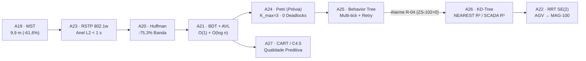

# Aula 28 — Avaliação e Simulação Integrada do Módulo 3

**UNIFEI • ECAA08 Automática • Grupo 2**  
**Projeto:** Aqua Index — SCADA da Máquina Pneumática de Envasamento de Água em Copos (Setores 000 a 500)  
**Escopo:** Síntese avaliativa e simulação integrada *end-to-end* das estruturas em árvore estudadas nas Aulas 19 a 28.

> **Declaração de Caráter Conceitual (`PRODUCT.md`):**  
> Todas as simulações, métricas e diagramas deste documento e do notebook acompanhante são **estudos conceituais e computacionais** sobre o caso de estudo **Aqua Index** (envasadora pneumática modelada no Automation Studio). Este trabalho **não** representa planta física construída nem reivindica certificação industrial SIL. Em qualquer cenário real, a parada de emergência **`HS-004` (`e1`)** opera em malha **hardwired** dedicada (relé de segurança / contatos secos NF), independente de software ou rede Ethernet.

---

## 1. Visão Sistêmica: Como as 9 Famílias de Árvores Cooperam na Aqua Index

Ao longo da **Etapa 03**, cada algoritmo baseado em árvore foi testado sob um critério rigoroso de **aderência física** ao processo discreto da envasadora (`E1` Dispensa, `E2` Envase `150 mL`, `E3` Tampa a Vácuo, `E4` Termosselagem `≥ 180 °C`, `E5` Ejeção e Esteira `EST-500`):

| Aula | Estrutura / Algoritmo | Camada da Arquitetura | Entrada Principal | Saída / Ganho Quantificado | Fronteira Honesta de Aplicabilidade |
| :---: | :--- | :--- | :--- | :--- | :--- |
| **19** | **MST (Kruskal & Prim)** | Infraestrutura Física (`PLC-001`, `MESA-001`, `E1–E5`, `EST-501`) | 14 trechos candidatos (`25,8 m`) | 7 trechos ativos (`9,9 m`), redução de **61,6%** | Sem redundância `N-1`; ruptura em trecho intermediário isola jusante. |
| **20** | **Árvore de Huffman** | Telemetria SCADA (vetor de 5 sinais críticos) | `[ZS-102, ZSC-203, PIT-301, TIT-401, ESD-001]` | `L = 1,2350 bits` vs. `5 bits` fixos (**-75,30%**), Kraft = `1` | Dicionário estático perde eficiência em chuvas severas de alarmes. |
| **21** | **BDT Contextual + AVL** | Intertravamento CLP (`O(1)`) + Historiador (`O(log n)`) | Contexto FSM + tags ISA-5.1 + eventos CoS | Ação única determinística + barramento paralelo + `|FB| ≤ 1` | BDT é *stateless*; precisa de lista paralela para não mascarar alarmes. |
| **22** | **RRT Cinemático `SE(2)`** | Camada Logística Externa (`G_V`: `ESTOQUE_COPOS → MAG-100`) | Alarme `R-04` (`ZS-102 = 0`) + `Φ_SCADA` (`HS-004`) | Rota contínua livre de colisão respeitando `R_min ≈ 1,32 m` | **Não se aplica** aos cilindros batente-a-batente da máquina interna. |
| **23** | **RSTP (IEEE 802.1w)** | Rede Ethernet L2 (`SW-SCADA`, `SW-PLC`, `SW-IO-*`) | 5 switches + 6 enlaces (`10G`, `1G`, `100M`) | Reconvergência `< 1 s` = **0 ciclos perdidos** no *takt* `3,6 s` | Complementa a MST com redundância lógica sem *loops* L2; `HS-004` segue *hardwired*. |
| **24** | **Redes de Petri** *(Entregável de integrante do grupo)* | Verificação Formal a Eventos Discretos | Lugares/Transições `E1–E5` + `K_max = 3` em `EST-500` | Prova de finitude (sem `ω`), `0` deadlocks e exclusão mútua Mesa×Prensa | Escopo reservado ao integrante do grupo; módulo simulador exibe prévia sincronizável. |
| **25** | **Behavior Tree (BT)** | Controle Reativo Multi-Tick (`PLC-001` / Supervisório) | `Fallback ?`, `Sequence →`, `Parallel ⇉`, `Retry(2)` | Suporte nativo a `RUNNING` (aquecimento `HT-401`, giro `M-001`) e preempção `HS-004` | Supera a natureza *stateless* da BDT e a explosão combinatória de FSMs monolíticas. |
| **26** | **KD-Tree (`R²` / `R³`)** | Historiador Multidimensional + Aceleração `NEAREST` do RRT | `[TIT-401, takt_s, tempo_vacuo_ms]` e amostras `(x,y)` | Busca `O(log N)` exata idêntica à força bruta com poda ortogonal | Eficiente em baixa dimensão (`k=2, 3`); degrada para `O(N)` quando `k ≫ 20`. |
| **27** | **Árvore de Decisão (ID3/C4.5/CART)** | Qualidade e Manutenção Preditiva no SCADA | 5 atributos contínuos/discretos → 4 classes de ciclo | Regras legíveis `SE ... ENTÃO ...` com acurácia `> 90%` em teste | Modelo estatístico **nunca** substitui intertravamento determinístico nem `HS-004`. |

---

## 2. Arquitetura de Fluxo Integrado (*End-to-End Pipeline*)

---

## 3. Matriz de Cenários Integrados Validados (Aulas 19–28)

Para avaliar o comportamento conjunto de todas as estruturas sem contradições entre camadas, definimos **4 cenários integrados** (executados tanto no notebook Python 3.13 quanto no Simulador Web em `doc/etapa-03-arvores.html`):

1. **Cenário 1 — Turno Nominal Estável (`nominal`):**
   - **MST & RSTP:** 7 trechos físicos (`9,9 m`), `SW-SCADA` como *Root Bridge* (`4096`), 4 enlaces *Forwarding* / 2 *Discarding*, `0` ciclos perdidos.
   - **Huffman:** quadro `00000` codificado em `1` bit (`L = 1,2350`, redução `75,30%`).
   - **BDT & AVL:** `OPERACAO_NORMAL`, índice AVL balanceado (`|FB| ≤ 1`).
   - **Petri (Prévia) & BT:** rede limitada (`K_max = 3`), BT retorna `RUNNING`/`SUCCESS` no ciclo `E1..E5`.
   - **KD-Tree, RRT & CART:** `RRT` em *standby* (`ZS-102 = 1`), `CART` classifica o ciclo como `CICLO_CONFORME`.

2. **Cenário 2 — Falta de Copo em E1 (`cup_shortage` — `ZS-102 = 0`):**
   - **Huffman:** símbolo `10000` (`00`, 2 bits) transmitido ao SCADA.
   - **BDT:** dispara nível 7 `ALARME_REABASTECIMENTO` (`R-04`) e pausa a estação.
   - **BT:** ramo de recuperação solicita `Pausar_e_Solicitar_MAG100` (`RUNNING`).
   - **KD-Tree + RRT `SE(2)`:** `Φ_SCADA = 0` (`HS-004 = 0`) libera o planejador; `KD-Tree` acelera o passo `NEAREST` em `R²` e `RRT` gera rota segura de `ESTOQUE_COPOS` até `MAG-100`.
   - **CART:** histórico classifica desvio como `PARADA_ABASTECIMENTO_ATRASO`.

3. **Cenário 3 — Falha de Backbone 10G (`RSTP`) + Selagem Fria (`TIT-401 = 168 °C`):**
   - **RSTP:** rompimento do enlace `SW-SCADA ↔ SW-PLC` (`10G`); RSTP promove a *Alternate Port* `SW-IO-IN ↔ SW-IO-PROC` em `< 1 s` (`0` ciclos perdidos no *takt* de `3,6 s`, contra `8–14` ciclos no STP 802.1D).
   - **BDT & BT:** `TIT-401 < 180 °C` aciona `HOLD_ESTAGIO_4` (`R-02`) na BDT e coloca o nó `Aquecer_HT401` da BT em estado `RUNNING` até atingir `≥ 180 °C`.
   - **KD-Tree `R³` & CART:** consulta `k-NN` no historiador `R³` recupera ciclos térmicos similares e `CART` sinaliza `RISCO_SELAGEM_FRACA`.

4. **Cenário 4 — Emergência Global (`emergency` — `HS-004 = 1`):**
   - **Malha Física:** corte *hardwired* imediato de `M-001`, `M-002` e `HT-401`, acionando `IL-002 = 1`.
   - **BDT & BT:** preempção instantânea no nível 1 (`TRIP_EMERGENCIA` / `Parada_Segura`), sobrepondo qualquer estado `RUNNING` ou `Retry`.
   - **RRT `SE(2)`:** barreira `Φ_SCADA = 1` aborta imediatamente o planejamento logístico (`ABORTO_EMERGENCIA`), impedindo aproximação à célula.

---

## 4. Rastreabilidade e Critérios de Aceitação do Módulo 3

- **Zero vazamento de domínio:** nenhuma referência a processos estranhos ao projeto **Aqua Index**.
- **Consistência de tags ISA-5.1:** todos os sensores e atuadores (`HS-004`, `ZS-102`, `ZSC-203`, `PIT-301`, `VAC-301`, `TIT-401`, `HT-401`, `ZSC-401`, `M-001`, `M-002`, `SE-001`, `EST-500`) correspondem ao mapeamento oficial da Etapa 01.
- **Execução reproduzível:** notebook [`Aula 28 - Avaliacao e Simulacao Integrada do Modulo 3 - code.ipynb`](./Aula%2028%20-%20Avaliacao%20e%20Simulacao%20Integrada%20do%20Modulo%203%20-%20code.ipynb) validado em Python 3.13 com asserções automatizadas e simulador interativo em [`doc/etapa-03-arvores.html`](../doc/etapa-03-arvores.html).
